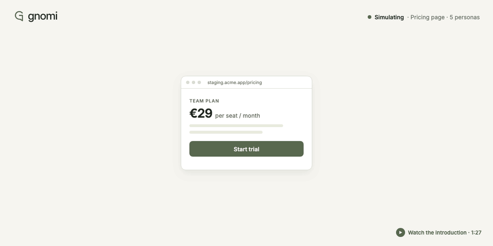

<p align="center">
  <a href="https://github.com/svichas/Gnomi#gh-dark-mode-only">
    
  </a>
  <a href="https://github.com/svichas/Gnomi#gh-light-mode-only">
    
  </a>
</p>

<p align="center">
  <a href="https://youtu.be/qgSt7nscow4">
    
  </a>
</p>

<p align="center">
  <a href="https://youtu.be/qgSt7nscow4">Watch the introduction on YouTube · 1:27</a>
</p>

# Perspective before you ship.

**Gnomi is a local desktop app for social simulation and product research.** Share your idea, staging app, or Figma design. Build an audience of simulated people, watch them explore your product and talk about it, and turn their experiences into evidence you can investigate.

For product teams, designers, founders, and engineers who want to know where people might get stuck—and what to test next.

[How it works](#how-it-works) · [Run locally](#run-locally) · [Try the demo](#try-the-demo) · [Development](#development) · [Documentation](#documentation) · [License](#license)

> Findings come from simulated users. Treat them as hypotheses, and validate important decisions with real people.

## What you can share

A project can contain several **points of interest**: the material each persona explores, in the order you choose.

| Starting point | What Gnomi works with |
| --- | --- |
| **An idea or product copy** | Pasted text, Markdown, or a plain-text file. Explore comprehension, objections, pricing, and buying intent. |
| **Your staging app** | A web URL, allowed hosts, and an optional recorded login. Personas navigate, click, type, and try to complete a goal. |
| **Design images** | An ordered sequence of PNG, JPEG, or WebP frames. Personas explain what they see, what they would do, and what they expect next. |
| **Your Figma design** | Selected frames imported as images through the Figma API, using your personal access token. Frame names become step names. |
| **A competitor's website** | An observe-only web input for comparison. Write requests are blocked, and navigation respects the configured robots rules. |

Design inputs are reviewed as static frames; importing Figma prototype interactions is still planned. See the [input guide](docs/pois.md) for formats, model requirements, and current limits.

## How it works

1. **Describe the product and the goal.** Add the material you want feedback on and explain what people should try to accomplish.
2. **Define your audience.** Choose segments, roles, countries, languages, devices, and profile attributes. Gnomi builds individual personas with their own goals and perspectives.
3. **Let them explore.** Each persona works through the relevant inputs. Web actions, thoughts, expectations, screenshots, and reported frictions are recorded.
4. **Watch the conversation.** Personas post, reply, and react in social rounds. Follow who heard an opinion, repeated it, or changed their view.
5. **Review the evidence.** Read ranked friction themes, affected segments, quotes, screenshots or text passages, and suggested changes. Decide what to investigate next.

## What you get

- **An audience you can inspect.** Individual profiles, configurable attributes, and user or buyer segments.
- **A live view of the run.** A social graph, activity timeline, feed, and persona inspector with current opinions.
- **Findings with context.** Evidence links, trust levels, segment breakdowns, suggested changes, and buying-survey results where applicable.
- **Reports you can share.** HTML, PDF, Markdown, and JSON exports.
- **Controls for the experiment.** Model routing, concurrency, step limits, social rounds, and recorded-cost budgets.
- **Projects on your machine.** Local project folders, event history, screenshots, and imported assets that you can reopen and inspect.

## Run locally

Gnomi currently runs from source using npm workspaces.

### Requirements

- **Node.js 24.15 or newer** and npm.
- **Chromium, Google Chrome, or Microsoft Edge** for browser-based runs. The commands below install the Chromium version used by this checkout.
- **A model provider key or a compatible local model server** for model-backed runs. Scripted demos and the default acceptance rehearsals need no provider key.

```sh
git clone https://github.com/svichas/Gnomi.git
cd Gnomi
npm ci
npx playwright-core install chromium
npm run dev
```

In the app, open **Settings** to add and test a provider, then select the models used by your project. Create a project, add your inputs, define the audience, and review the run settings before starting.

| Provider | Configuration |
| --- | --- |
| Anthropic | API key in Settings |
| OpenAI | API key in Settings |
| Google | API key in Settings |
| DeepSeek | API key in Settings; V4.1-Flash navigates with screenshots |
| Local OpenAI-compatible server | A project-specific endpoint, such as an Ollama or LM Studio server |

Static-design inputs require an image-capable navigator; the current preflight accepts Anthropic, OpenAI, and Google routes for them. For Figma imports, add and test a personal access token under **Settings → Figma**, then choose **Add from Figma** in the project's inputs.

### Try the demo

The repository includes **Gym**, a small applicant-tracking app with deliberately seeded UX defects and a defect-free control. It also includes design sequences and pricing copy for testing the other input types.

Start it in a second terminal:

```sh
npm run gym
```

Use `http://localhost:4317` as a web input in Gnomi. To exercise the engine without model calls, leave Gym running and use the scripted CLI:

```sh
npm run cli -w @gnomi/simulation -- \
  --url http://localhost:4317 \
  --goal "Create a job post" \
  --allow localhost \
  --fake-llm \
  --project ./demo.gnomi
```

This writes a local project, events, screenshots, and report artifacts. Scripted answers are fixtures for checking the workflow, not model-generated research findings. The CLI runs one built-in persona; audience setup and login recording are available in the desktop app. For a live CLI run, supply `ANTHROPIC_API_KEY` in your environment and omit `--fake-llm`.

See the [Gym guide](demo/GymSite/README.md) for the design and text fixtures, or start the web control with `GYM_DEFECTS=none npm run gym`.

## Local storage and model access

Projects and simulation execution stay on your machine. Model inputs are sent to the provider you configure; web runs connect to the hosts you allow, and Figma imports connect to Figma and its image storage. Settings shows where Gnomi connects.

Provider keys and Figma tokens are kept outside project folders, encrypted using the operating system's secure storage when available. When secure storage is unavailable, keys are retained only for the app session. Recorded login sessions are encrypted separately.

Interactive web runs are intended for your staging or test environments. Use the observe-only mode for competitor sites. Cost budgets stop further work at the recorded threshold; requests already in flight may still be billed by your provider.

## Development

Run these commands from the repository root:

| Command | Purpose |
| --- | --- |
| `npm run dev` | Start the Electron app with the development renderer and watched builds. |
| `npm run gym` | Start the local Gym web app. |
| `npm test` | Run the workspace test suites. |
| `npm run typecheck` | Type-check the workspaces. |
| `npm run build -w @gnomi/app` | Build the desktop application code. |
| `npm run smoke -w @gnomi/app` | Build and run the scripted Electron smoke check. |
| `npm run smoke:poi -w @gnomi/app` | Check the input setup flows in Electron. |
| `npm run smoke:figma -w @gnomi/app` | Check the Figma import flow against the fixture API. |
| `npm run acceptance -w @gnomi/simulation -- --m5 --out /tmp/gnomi-m5-demo` | Run the text/design acceptance rehearsal without provider calls; use a fresh output directory. |

Live acceptance runs are opt-in and require provider credentials and an explicit spending allowance. The [acceptance guides](#documentation) distinguish structural checks, live measurements, and findings that still need review.

### Repository map

| Directory | Contents |
| --- | --- |
| [`app/`](app/) | Electron shell and React UI: projects, audience editor, inputs, live graph, activity, and reports. |
| [`simulation/`](simulation/) | TypeScript simulation runtime: Playwright browser actions, provider routing, social rounds, SQLite event storage, and reports. |
| [`engine/`](engine/) | Host process for the desktop app: project and audience authoring, Figma import, and the message protocol around the simulation. |
| [`demo/GymSite/`](demo/GymSite/) | Demo web app, defect catalogue, design frames, and text fixtures. |
| [`docs/`](docs/) | Product design, architecture, input contracts, evaluation guides, and roadmap. |
| [`assets/brand/`](assets/brand/) | Logos, icons, typography, and brand assets. |
| [`videos/`](videos/) | The introduction video, editable film project, audio, 3D models, animation source, and the README animation (`readme-gif/`, rebuilt with `node videos/readme-gif/render.mjs`). |
| [`tasks/`](tasks/) | Implementation plans and progress notes. |

The desktop shell runs the engine in a separate process. The engine drives browser contexts and model calls, recording events in SQLite and evidence in local files. The graph, activity views, persona inspector, and reports are built from that history. The UI uses React and Sigma.js; model access uses the Vercel AI SDK.

## Documentation

| Guide | Start here for… |
| --- | --- |
| [Product idea](docs/idea.md) | The problem, intended users, and simulation design. |
| [Technical design](docs/tech.md) | Architecture, data flow, containment, and model integration. |
| [Points of interest](docs/pois.md) | Web, text, design, competitor, and Figma inputs. |
| [Persona generation](docs/persona-generation.md) | Audience generation, saved profiles, retries, and diagnostics. |
| [Roadmap](docs/roadmap.md) | Milestones, measured progress, and remaining work. |
| [Brand guide](docs/brand.md) | Gnomi's visual identity and writing principles. |
| [Audience acceptance](docs/m2-acceptance.md) | Population, locale, budget, and provider checks. |
| [Friction/report acceptance](docs/m3-acceptance.md) | Detection, evidence, ranking, and report evaluation. |
| [Social acceptance](docs/m4-acceptance.md) | Opinion spread and influence evidence. |
| [Text/design acceptance](docs/m5-acceptance.md) | Copy comprehension, frame expectations, and Figma checks. |

Gnomi is under active development. Some design documents describe the intended architecture or future work. The input guide and acceptance guides record implementation limits and validation status; Figma imports have fixture coverage, while real-file validation remains open in the current documentation.

## Video and creative assets

The introduction is **87 seconds, 1080p, at 24 fps**, with ElevenLabs narration, music, and sound effects, plus animated 3D models and app captures assembled in Synthcut.

[Watch on YouTube](https://youtu.be/qgSt7nscow4) · [Download the video](videos/output/gnomi-film/Gnomi-explainer.mp4) · [English subtitles](videos/output/gnomi-film/Gnomi.en.srt) · [Storyboard](videos/output/gnomi-film/storyboard.jpg) · [Editable source bundle](videos/output/gnomi-film/Gnomi-editable.zip) · [3D personas](videos/output/gnomi-film/assets/gnomi-personas.glb)

To edit the film, download and extract the source bundle. From the directory where you extracted it, rebuild the project's media paths:

```sh
python3 Gnomi-film/source/relink-project.py
```

Then open `Gnomi-film/Gnomi-relocated.aive` in Synthcut. The [narration script](videos/output/gnomi-film/narration.txt) and [production notes](videos/output/gnomi-film/production-notes.txt) are included alongside the film.

## License

Gnomi is licensed under the [GNU Affero General Public License v3.0](LICENSE) (`AGPL-3.0-only`). You can use, study, modify, and share it. If you distribute a modified version, or let others use one over a network, you must make its complete source available under the same license.

For a commercial license without these obligations, contact the maintainer through [GitHub](https://github.com/svichas).
