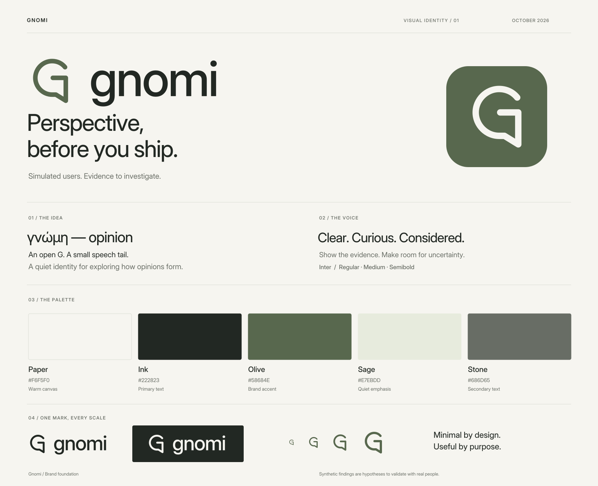

# Gnomi — brand foundation

*Version 1 · 2026-10-15. A minimal identity grounded in [tech.md](tech.md).*

## 1. The idea

**Gnomi means “opinion” in Greek: γνώμη.** The name is the starting point for the identity. Gnomi gives product teams another perspective before they ship: simulated people use a product, encounter friction, and exchange opinions. Teams can inspect simulation records and decide which hypotheses to investigate with real users.

The brand should feel like a thoughtful research tool: clear, observant, approachable, and comfortable with uncertainty. Its visual restraint leaves room for the people, quotes, screenshots, and findings inside the product.

| Element | Direction |
|---|---|
| Product name in prose | **Gnomi** |
| Name in the artwork | **gnomi**, lowercase |
| Greek origin | **γνώμη — opinion**; use in the brand story, without adding it to every logo |
| Primary audience | Product designers, product managers, and founders; researchers and engineers also use it |
| Short descriptor | **Social simulation for product teams.** |
| Primary line | **Perspective before you ship.** |
| Supporting line | **Simulated users. Hypotheses to investigate.** |
| Social-feature line | **See how opinions form.** |

**One-sentence description:** Gnomi lets simulated users try your product and exchange opinions, helping your team find potential UX friction and decide what to test with real people.

These are positioning foundations. Public copy must reflect the features available in the relevant release; the roadmap describes planned capabilities as well as the product direction.

## 2. Principles

- **Make the run inspectable.** Show screenshots and recorded actions, and label persona quotes as generated. These records document the simulation, not real users’ needs.
- **Room for disagreement.** Different segments can have different experiences. Preserve those differences instead of making everything one score.
- **Calm by default.** Use space, type, and alignment to establish hierarchy. Color should signal something useful.
- **Honest about simulation.** Describe personas as simulated people and findings as hypotheses. “Confirmed” is a trust label within a simulation, not proof from real users.
- **Control stays visible.** Budgets, run status, evidence, and stop actions should be easy to find.

## 3. Logo and icon

The **opinion mark** is an open capital G with a small speech tail. The G anchors it to Gnomi; the tail connects it to the name’s meaning and the product’s conversations. One continuous stroke gives it a simple silhouette at small sizes. Rounded ends keep it approachable.

The primary logo pairs the Olive mark with an Ink lowercase wordmark. The wordmark is set from Inter Medium with adjusted spacing and converted to vector paths. Use the supplied artwork to preserve its spacing.

| Asset | Use |
|---|---|
| [Primary logo](../assets/brand/gnomi-logo.svg) | App headers, documentation, report covers, light marketing surfaces |
| [Monochrome logo](../assets/brand/gnomi-logo-mono.svg) | Single-color printing and restrained layouts |
| [Light logo](../assets/brand/gnomi-logo-light.svg) | Sage mark and Paper wordmark for dark interfaces, including GitHub |
| [Reversed logo](../assets/brand/gnomi-logo-reversed.svg) | Ink or Olive backgrounds |
| [Wordmark](../assets/brand/gnomi-wordmark.svg) | Tight horizontal placements where the symbol already appears nearby |
| [Olive icon](../assets/brand/gnomi-icon.svg) | Compact navigation, avatars, favicon source |
| [Ink icon](../assets/brand/gnomi-icon-mono.svg) / [reversed icon](../assets/brand/gnomi-icon-reversed.svg) | Monochrome and dark placements |
| [App icon](../assets/brand/gnomi-app-icon.svg) | Olive tile with the reversed mark; desktop and launcher artwork |

### Placement

- Keep clear space of at least **one quarter of the icon’s displayed canvas height** around a standalone icon or the symbol within a logo. In the supplied 260 × 80 logo, that is 16 source units. Clear space is additional to the artwork’s transparent bounds.
- Minimum logo width: **104 px** digitally or **28 mm** in print. Prefer 130 px or wider in ordinary headers.
- Minimum standalone icon: **16 × 16 px**. Prefer 24 px or larger in the interface; 16 px is for favicons and similarly constrained contexts.
- Use the standalone mark below 32 px. The rounded app tile is intended for larger launcher contexts.
- Keep the supplied proportions. Do not rotate, stretch, add shadows, change the stroke, fill in the counter, or attach extra dots and nodes.
- Use the primary logo on Paper or white. Use the reversed logo on Ink or Olive. Avoid photography and busy graph content directly behind it.
- The logo does not need the tagline attached. Keep the tagline as ordinary text in the surrounding layout.

SVGs have transparent backgrounds except for the app icon. Logo lettering is outlined, so the artwork does not need a font installed. PNG exports and a multi-size favicon are listed in the [asset index](../assets/brand/README.md).

## 4. Brand colors

The palette is warm, quiet, and deliberately small. Paper creates the working surface; Ink provides clarity; Olive supplies recognition. Sage is a supporting tint. Stone keeps secondary information readable.

| Color | Hex | RGB | Role |
|---|---|---|---|
| **Paper** | `#F6F5F0` | 246, 245, 240 | Main canvas, warm light background |
| **Ink** | `#222823` | 34, 40, 35 | Headings, body text, monochrome artwork |
| **Olive** | `#58684E` | 88, 104, 78 | Brand mark, primary actions, links, focus |
| **Sage** | `#E7EBDD` | 231, 235, 221 | Selected surfaces and quiet emphasis |
| **Stone** | `#686D65` | 104, 109, 101 | Secondary text and metadata |
| White | `#FFFFFF` | 255, 255, 255 | Inputs, evidence cards, report sheets |
| Line | `#D8DCD2` | 216, 220, 210 | Decorative separators and subtle grouping |
| Control | `#87917D` | 135, 145, 125 | Essential input and control boundaries on Paper or white |

Aim for roughly **85% neutral surfaces, 10% Sage support, and 5% Olive emphasis** on ordinary screens. This is a composition guide, not a rule for charts or the app icon. One primary action per region is usually enough. Use Ink for long passages; reserve Olive text for short actions and links.

Primary button: Olive fill with Paper text. Hover: `#47573E`. Selected row: Sage fill with Ink text and a visible selected indicator. Links remain underlined where surrounding text makes their purpose ambiguous. Use an Olive focus ring with a Paper gap around filled controls.

### Contrast

Calculated from the exact sRGB values above, with no transparency:

| Foreground / background | Contrast |
|---|---:|
| Ink / Paper | 13.78:1 |
| Stone / Paper | 4.85:1 |
| Olive / Paper | 5.49:1 |
| Paper / Olive | 5.49:1 |
| Olive / Sage | 4.94:1 |
| White / Olive | 5.99:1 |
| Control / Paper | 3.02:1 |

Use at least 4.5:1 for ordinary text and 3:1 for essential control boundaries and graphical information, following the W3C explanations for [text contrast](https://www.w3.org/WAI/WCAG22/Understanding/contrast-minimum.html) and [non-text contrast](https://www.w3.org/WAI/WCAG22/Understanding/non-text-contrast.html). Line is decorative and too faint to identify an input by itself. Do not reduce Stone text opacity. These pair checks are not a claim that a complete interface is accessible.

### Dark surfaces

Keep the same quiet character. Use the reversed artwork, with these role substitutions:

| Role | Dark value |
|---|---|
| Canvas / surface | Ink `#222823` / `#2D352D` |
| Primary / secondary text | Paper `#F6F5F0` / `#ADB5A7` |
| Action and focus | `#B8C8A9`, with Ink text on filled actions |
| Action hover | `#C9D6BD` |
| Selected surface | `#3C4936`, with Paper text |
| Decorative line / control boundary | `#46503F` / `#87917D` |

Secondary text and accent against Ink measure 7.12:1 and 8.51:1 respectively. Do not place the light-theme Olive text on Ink.

## 5. Product colors carry meaning

Brand color, audience segment, sentiment, severity, and evidence trust are different dimensions. Keep their legends explicit.

| Status | Light color | Dark color | Treatment |
|---|---|---|---|
| Success / completed | `#34704F` | `#9EC9A9` | Check icon plus a label |
| Warning / attention | `#90651E` | `#DFC28A` | Attention icon plus a label |
| Error / blocked | `#AA5147` | `#E7ADA3` | Error icon plus a label and recovery action |
| Information | `#496D85` | `#A8C5D8` | Neutral explanatory label |

The light status colors each exceed 4.5:1 on Paper. Use their dark counterparts on the dark canvas and surface; do not exchange light and dark values arbitrarily.

For light-background audience graphs, use this categorical sequence: Olive `#58684E`, Slate blue `#56768A`, Plum `#8A6A83`, Ochre `#A27B36`, and Teal `#417F78`. Each exceeds 3:1 against Paper; some are unsuitable for small text, so use Ink labels. Pair color with segment names, shapes or line styles. Separate adjacent colored marks with Paper when needed; the palette does not guarantee contrast between every pair of colors. On dark graphs, use light tints from the status palette plus `#CAB4CC` for plum, and preserve labels and shape distinctions. These are categorical assignments, not status meanings.

Keep a segment’s assignment stable across runs and comparisons. Use a contrasting selection outline with a canvas-colored gap rather than recoloring the selected node. Sentiment uses a labeled scale with a visible neutral midpoint; trust uses explicit **Confirmed / Observed / Reported** labels. A green badge alone must never imply that a finding is validated by real people.

## 6. Typography

Use **Inter** for the interface, reports, and brand copy. Its variable font supports the weights and optical sizes needed for dense product UI and larger headings. The local font includes the Greek characters used in the name story. See the [official Inter site](https://rsms.me/inter/) and the bundled [font and license](../assets/brand/fonts/OFL.txt).

| Use | Size / line height | Weight | Tracking |
|---|---|---|---|
| Marketing headline | 48–64 px / 1.08 | 450–500 | −0.03em |
| Page title | 28–32 px / 1.2 | 500 | −0.02em |
| Section title | 20–24 px / 1.3 | 500 | −0.01em |
| Body and report text | 16 px / 1.6 | 400 | Normal |
| UI labels and table cells | 14 px / 1.45 | 400–500 | Normal |
| Supporting metadata | 12–13 px / 1.5 | 400–500 | Normal |

Use semibold 600 sparingly for emphasis. Keep headings in sentence case. Uppercase is reserved for short editorial labels, with generous tracking; do not set ordinary controls in uppercase. Use tabular numbers for cost, duration, counts, and comparisons. A system monospace face is appropriate for run IDs and seeds.

Bundle the font locally to match the desktop product’s offline behavior; avoid a remote font request. The supplied [brand-tokens.css](../assets/brand/brand-tokens.css) contains the local font declaration and the color roles. Fallback: `Inter, -apple-system, BlinkMacSystemFont, "Segoe UI", sans-serif`.

## 7. Layout and visual language

- Use a 4 px spacing base, with 8, 12, 16, 24, 32, 48, and 64 px steps. Favor alignment and whitespace over extra containers.
- Use 8 px corners on ordinary controls, 12 px on larger panels, and 4 px on small evidence thumbnails. The app icon has its own larger radius.
- Separate rows with quiet rules. Reserve shadows for floating menus and dialogs. Avoid gradients, glass effects, decorative glows, and ornamental background graphs.
- Keep long-form text around 60–75 characters per line. Screenshots and charts may use the full content width.
- Prefer actual product evidence: legible screenshots, short persona quotes, and labeled diagrams. Simulated personas should remain clearly identified as synthetic.
- Use a consistent 1.5–2 px stroke for interface icons at 20–24 px. The brand mark is separate artwork; do not force its geometry onto every UI icon.
- Show run activity through labeled state changes and restrained 120–180 ms transitions. Respect reduced motion. Keep the graph readable without perpetual pulsing.

**An example report composition:** small logo and project name at the top, a visible synthetic-findings notice, a concise summary, then ranked findings with segment counts, evidence, trust labels, and suggested changes. The screenshot and quote should be more prominent than a decorative card border. Avoid a single “Gnomi score” that could suggest a validated verdict.

## 8. Voice and writing

Write like a thoughtful colleague reviewing a product. Be specific about what happened, whose simulated experience it affected, and what the team can inspect next. Use plain language in the interface; introduce technical terms only when they help a decision.

| Context | Preferred language | Avoid |
|---|---|---|
| Product introduction | “Explore potential friction before you ship.” | “Know exactly what your users think.” |
| Finding | “8 of 20 simulated users could not find the next step.” | “40% of your customers will fail.” |
| Suggested change | “Consider keeping the action visible while scrolling.” | “The AI has found the perfect solution.” |
| Completed run | “Run complete. Review 6 potential frictions.” | “Your product has been validated.” |
| Budget stop | “Budget reached. Your partial report is ready.” | “Something went wrong.” |
| Privacy | “Projects are stored locally. Model inputs are sent to your configured provider.” | “Your data never leaves your device.” |

Example numbers above are illustrative copy, not measured results or performance claims.

Use **simulated users** in introductions and **personas** after the term is established. Prefer **friction hypothesis**, **simulation records**, **generated quote**, **suggested change**, **compare runs**, and **validate with real users**. Use **evidence** only with an explicit scope, such as evidence of a browser error during a run; never imply human validation. Keep “swarm” for the feature name or contexts where the social simulation has been explained.

Recommended report notice:

> Simulated findings are hypotheses, not evidence about real users. Screenshots and logs document the simulation; quotes and opinions are generated. Use the report to choose what to investigate with real people.

Explain persona generation when introducing the product: the team defines audience segments and trait distributions; seeded code samples traits; a language model proposes fictional candidates and expands the selected biography; the team reviews the profiles. These encode audience assumptions, not a representative sample. See [Persona generation](persona-generation.md) and [Interpreting simulations](interpreting-simulations.md).

When describing local operation, preserve the product’s boundary: local storage and execution still allow requests to the configured model provider and the permitted product hosts. Treat roadmap budgets, timings, and evaluation targets as targets until there are dated measurements.

## 9. Files and adoption

The full [asset index](../assets/brand/README.md) includes SVG masters, transparent PNGs, the app icon, favicon, local font, and CSS tokens. The [visual board](../assets/brand/brand-board.svg) shows the identity as a single shareable composition.

This document establishes the design direction. The asset kit is ready to use; importing its tokens, updating app screens, and configuring packaged application icons are separate implementation steps. Keep this guide, the token values, and the artwork in sync when the identity changes.

### Product grounding

- [Technical design](tech.md): local desktop operation, configured providers, replayable evidence, and readable reports.
