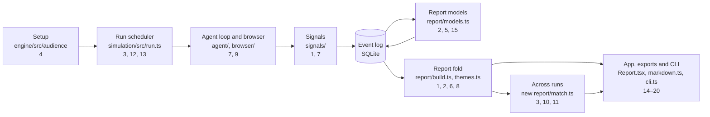

# Gnomi — features roadmap

*Status: in progress, updated 2026-10-30. See [Progress](#progress) for what is built. Companion documents: [roadmap.md](roadmap.md) (milestones), [tech.md](tech.md) (architecture) and [new_simulation.md](new_simulation.md) (evaluation rules). Sizes are estimates for one engineer: S is up to a few days, M is one to two weeks, L is three weeks or more.*

## Summary

This document ranks what to build next, with better results first. "Better results" means three things, in this order: findings are more often real, they repeat across runs, and they match what real people do. Reports, integrations and polish come after that.

Most ideas come from competitors. Items 0, 1, 2 and 9 come from Gnomi's own run data and design docs, because they affect results more directly than several competitor features.

| Rank | Feature | What it improves | Size | Needs | Idea came from |
|---|---|---|---|---|---|
| **0** | [Results scoreboard](#0-results-scoreboard) | Lets us prove every item below | S–M | none | Gnomi's evaluation plan |
| | **Tier 1: more correct findings** | | | | |
| **1** | [Noise cuts](#1-noise-cuts) | False findings | S | none | 16 October run data |
| **2** | [Finding check](#2-finding-check) | False findings | M | Block B | Gnomi's comparison pipeline |
| **3** | [Repeat-run reliability](#3-repeat-run-reliability) | Stability, shared model bias | M | Block A | Versive, Ask Rally |
| **4** | [Personas grounded in real data](#4-personas-grounded-in-real-data) | Realism, relevance | L | none | Synthetic Users, Versive, Ask Rally, Blok |
| **5** | [Real-user validation loop](#5-real-user-validation-loop) | Agreement with real people | M | Block C | Versive, Ask Rally, Blok |
| | **Tier 2: fewer missed problems** | | | | |
| **6** | [Coverage and saturation](#6-coverage-and-saturation) | Recall, cost | S–M | none | Synthetic Users |
| **7** | [Accessibility scan and perception limits](#7-accessibility-scan-and-perception-limits) | Recall of accessibility defects | M | none | Persona Runner, CBrowser |
| **8** | [Which traits drive each issue](#8-which-traits-drive-each-issue) | Segment attribution | S–M | none | UXCascade |
| **9** | [Stop rule for stuck personas](#9-stop-rule-for-stuck-personas) | Realistic abandonment | S | Item 0 first | tech.md §6.8 |
| | **Tier 3: results across builds** | | | | |
| **10** | [Before/after comparison](#10-beforeafter-comparison) | Shows whether a fix worked | S–M | Block A, item 3 | Persona Runner, Zaplens, UXCascade |
| **11** | [CI gate](#11-ci-gate) | Catches regressions | S | Item 10 | Persona Runner, Swarm |
| **12** | [Returning personas](#12-returning-personas) | Realism for repeat use | M | Item 10 | Swarm |
| **13** | [What-if social runs](#13-what-if-social-runs) | Depth of the social layer | M | Item 3 | Artificial Societies |
| **14** | [Ask a persona](#14-ask-a-persona) | Depth of explanations | M | Block C | UXAgent, Synthetic Users, Sybil-Swarm |
| | **Tier 4: reading the results** | | | | |
| **15** | [Written summary](#15-written-summary) | Clarity | S | none | Synthetic Users, Maze |
| **16** | [Plain priority labels](#16-plain-priority-labels) | Clarity | S | none | Versive |
| **17** | [Drop-off flow](#17-drop-off-flow) | Clarity | M | none | UXCascade |
| **18** | [Findings on the screenshot](#18-findings-on-the-screenshot) | Clarity | M | none | Zaplens, UXCascade |
| **19** | [Edit before sharing](#19-edit-before-sharing) | Sharing | S–M | Block C | Maze |
| **20** | [Replay from step screenshots](#20-replay-from-step-screenshots) | Evidence | S | none | Versive, Maze |

The research produced three conclusions that shape this order:

- **We could not prove that a feature improves results.** The evaluation harness compared completion, abandonment, theme counts and cost, but not recall or precision, so item 0 came first.
- **False findings are the most visible problem.** The Gym's defect-free control build still produced six themes on 16 October, and every theme that matched no defect on the defect builds belonged to one of three kinds also seen on the control build. That is why items 1 and 2 outrank grounding.
- **One small block unlocks five features.** Items 3, 10, 11, 12 and 13 all need to tell whether two themes from different runs are the same problem. Theme ids cannot do that today, so [Block A](#block-a-theme-matching-across-runs) is built once and reused.

## Progress

Work lands on the `claude/features-roadmap` branch. It is not on `main` yet, and nothing here has had a live run.

| Item | Status | Verified | Left to do |
|---|---|---|---|
| 0. Results scoreboard | Steps 1–4 built, reviewer findings closed | Scripted rehearsal passes. Scoring the saved mapping reproduces the published 0.4, 0.71 and 0.67. A person's corrections now change the numbers through `--rescore` | Step 5, the live baseline, which needs a spending decision |
| 1. Noise cuts | Built, reviewer findings closed | Rebuilding the saved control report gives 4 themes, down from 6. The interference tag has unit tests on constructed logs only | The tag has never fired on a real run, because the Gym cannot show personas breaking each other's work |
| 2. Finding check | Built, off by default | Scripted tests of each verdict, stale answers and failed calls | Its proof: `gnomi rejudge --check` on the saved logs, which needs a spending decision. No settings control in the app yet |
| 3. Repeat-run reliability | Steps 1–6 built | Scripted tests, including a stopped set and the CLI path. `--evaluate` now reports stability per arm | Step 7, the trait-free run. Whether real findings repeat is unmeasured |
| 6. Coverage and saturation | Built | Tests of curves, short runs, stopped runs, several POIs and old logs, and the report smoke test at 320 px | Its proof: the curve against known Gym defects across run sizes |
| 7. Accessibility scan and perception limits | Built, off by default | On the real Gym with no model, the scan finds D10 and D24, and the control build has no violations at all. It does not find D06. `blurredVision` passed a pixel test on real text | Recall in the `accessibility` arm, and whether colour and low-vision personas notice D22 more. No settings control in the app yet |
| 8. Which traits drive each issue | Built | Tests of each limit, and the report smoke test | Its proof: segment attribution on the Gym |
| 10. Before/after comparison | Built | The M6 test passes on the real Gym with a scripted navigator: with D01, D14 and D16 switched off, exactly those three read as fixed. On the saved runs against the control build, all three themes read as fixed are real defects (D12, D13) | A live run. The 0.6 overlap for a duplicated run is unmeasured |
| 15. Written summary | Built | Tests of ten report shapes, and the report smoke test | How it reads on real reports |
| 16. Plain priority labels | Built | Tests of the rule, and the report smoke test | How the labels read on real reports |
| 17. Drop-off flow | Built | Tests, plus the report smoke test at 320 px and in the HTML export | Usefulness on real logs is unmeasured |
| 18. Findings on the screenshot | Built, for new runs | Real-browser tests put the box within 2 px of the element, on desktop, scrolled, on a phone, zoomed out and panned | Usefulness on real logs is unmeasured |
| 20. Replay from step screenshots | Built | The report smoke test flips through steps by button and keyboard, at 320 px | Not tried with a real screen reader |
| Block A: theme matching | Built | On the rebuilt M3 seeds, D03, D04, D13 and D18 match with no false pair | D12 does not match, and one false pair remains against the control build, now marked as weak in comparisons |
| Block B: page text | Built, and the author now reads it | Unit tests, on scripted runs | Whether suggestions improve is unmeasured |

Everything else has not started. All 1,214 tests pass on the branch, with typecheck and lint clean, and the Electron main, report, text and UI smoke tests pass. The report smoke test now reaches the set-aside section, the repeat count and "Appeared in 2 of 2 runs" on a real two-run set. No live run has used these changes. GitHub CI is blocked by a billing problem, so these checks ran locally.

CI's smoke job runs the main smoke test, not the report one, so the 320 px checks in the report smoke test guard nothing there until it is added.

## What "better results" means

The metrics already exist in [roadmap.md](roadmap.md#evaluation-plan). This table shows the targets and the only live measurement so far.

| Metric | Target | 16 October result |
|---|---|---|
| Recall of high-severity defects | at least 0.6 | 0.4: 4 of 10 found (D03, D04, D13, D18) |
| Precision of a report's top 20 themes | at least 0.7 | 0.71 and 0.67 |
| Stability: top-ten overlap across seeds | at least 0.6 | 0.83 |
| Control build | no confirmed themes, at most two reported | Failed: 6 themes, 2 confirmed and 1 reported |

Treat these numbers as a rough signal. That run used 4 personas, 2 seeds, no social rounds and a DeepSeek navigator without images. Claude mapped the themes to defects, not a human. Together with the control run it cost $0.27.

What the run shows:

- **The false findings fall into a few kinds.** Five themes on the defect builds matched no defect. All five were about small tap targets, backtracking or the Candidates placeholder, and all three kinds appeared on the control build too.
- **Two control themes were agent mistakes.** One persona typed its own name as the hiring manager, and one could not read a checkbox state, which a prompt change has since fixed. A third, about a feedback field that looked empty, is not catalogued.
- **One goal could not be done on any Gym build.** It produced the Candidates theme, so the fixture needs fixing as well as the product.
- **Most misses look like coverage, not judgement.** Six high-severity defects were missed. D21 and D25 are visual-only, and this run had no images. D02, D08 and D14 need a specific input or path, and D05 needs a narrow screen with the resume scrolled past. Four personas took only 48 to 58 steps per run.

So the first gain in recall is likely to come from a run at real scale with images on, before any new feature.

### How a feature proves itself

Every feature in tiers 1 and 2 ships with an arm in `ARMS` ([checks.ts](../simulation/src/acceptance/checks.ts)), which `--evaluate` compares with the baseline over matched replicates using `pairedDifference`.

- A feature stays on by default when its paired interval excludes zero in the right direction on its target metric and no other metric gets worse. Otherwise it stays behind a setting.
- With five replicates, intervals will often be wide. An unclear result counts as inconclusive, never as a pass ([new_simulation.md §9](new_simulation.md#9-scientific-evaluation-and-acceptance)).
- Features that only change the analysis can be tested without browsing. `gnomi rejudge` reruns the judge and author on a saved log, and the logs of 16 October are still in `acceptance-results/2026-10-16-deepseek/`. That folder is git-ignored, so copy what we need before it is lost.
- Gym results show defect detection only. They do not show that personas behave like people. Items 4 and 5 need real human data.

## Where features plug in

The numbers are ranks from the summary table. The design holds up well for this work, because the report is a pure fold over the event log and model answers are recorded as events ([tech.md §5.1](tech.md#51-source-of-truth-one-append-only-event-log)). Most features add a fold or a new event type, and none needs a new database table.

## Shared building blocks

### Block A: theme matching across runs

Theme ids are positions such as `g1+g4`, so they mean nothing outside one run. [tech.md §8.2](tech.md#82-pipeline) already defines the match: POI, page pattern and element first, then title similarity.

1. Add `keys: string[]` to `ReportTheme` ([report/types.ts](../simulation/src/report/types.ts)), filled in `analyseFrictions` with `groupKey` for each group in the theme.
2. Add a pure `matchThemes(a, b)` in a new `simulation/src/report/match.ts`. Compare key sets first, because the judge may merge groups differently in each run. Fall back to `similarity` from [report/similarity.ts](../simulation/src/report/similarity.ts) on titles.
3. Add the file to the explicit `exports` map in [simulation/package.json](../simulation/package.json) if the engine or app imports it.

Size: S. Test it on the two M3 seed reports, where D03, D04, D12, D13 and D18 should match.

Measured on the rebuilt M3 seed reports: D03, D04, D13 and D18 match, with no false pair. D12 does not: its titles score 0.10 and it shares no key, and a lower title threshold would let in false pairs at 0.15. The order became a strong key overlap (above 0.3), then titles, then any shared key, because one shared key is often chance; keys are compared without their host, because each Gym build runs on its own port. Against the control build one false pair remains: D12's theme and a backtracking theme share the link "Settings" on `/settings/users`. Item 10 handles this by giving a pair on one shared key its own kind, `shared_key`. A comparison shows it as a weak match with both titles, and never as fixed. Repeat sets and the stability metric still count such pairs.

### Block B: page text kept with each step

The persona's page text exists only inside the navigator's transcript, so the report models cannot see it. The shortcut in [report/models.ts](../simulation/src/report/models.ts) says the same about the author.

`look()` in [agent/loop.ts](../simulation/src/agent/loop.ts) already writes the screenshot through `BlobStore`. Add one more `blobs.put` to `runs/<run_id>/snapshots/<snapshot.hash>.txt`. The step event already stores `snapshot_hash`, which is a hash of that text, so no event or schema changes. Identical pages share one file, and old logs simply have no file.

Size: S. There is an immediate gain: pass the text to the author, as [tech.md §8.2](tech.md#82-pipeline) step 6 intended, so suggested changes can name the real page.

These files hold page text as the page showed it. Key-pattern redaction happens in the model gateway, so it covers what is sent and not what is stored here. Anyone who copies a run folder copies that text.

### Block C: changes after a run has ended

`rejudge` in [cli.ts](../engine/src/cli.ts) shows the pattern: append events to a finished run, rebuild with `buildReport`, rewrite the report files and record `report.generated` so an open app reloads. The app has no equivalent, because `Api` in [protocol.ts](../engine/src/protocol.ts) has no such method.

Move that sequence into one function in [workspace.ts](../engine/src/workspace.ts), then call it from the CLI and a new `Api` method in [host.ts](../engine/src/host.ts). Items 5, 14 and 19 use it. Any event that refers to a theme stores its Block A keys, because theme ids change after a rejudge.

Size: S.

## Rank 0: measure first

### 0. Results scoreboard

**Why.** The harness pairs themes with defects by page only (`defectScores`), and its output is labelled as never a compared metric. `METRICS` in [acceptance/run.ts](../simulation/src/acceptance/run.ts) leaves out recall and precision, and `--evaluate` runs only the all-defects build, so false positives go unmeasured.

**How.**

1. Add `element` or a short matching hint to each entry in [defects.yaml](../demo/GymSite/defects.yaml), so a theme can map to a defect by more than its page.
2. Add a mapping step that uses a judge from a different model family, as [roadmap.md](roadmap.md#evaluation-plan) requires, and have a person review a sample.
3. Add `recall_high`, `precision` and `control_themes` to `METRICS`, and add a control build arm alongside `startGym({ defects: 'all' })`.
4. Fix the fixture goal that no Gym build supports ([acceptance/fixture.ts](../simulation/src/acceptance/fixture.ts)).
5. Run a baseline with a vision-capable navigator at 20 personas or more.

**Cost.** The 16 October runs cost a little over 2 cents per persona. Pro rata, 20 personas cost about $0.45 a run, and 5 repeats of 3 arms on 2 builds cost about $14. Images and social rounds will raise that, so set `--allowance-usd`.

**Overlap.** This is largely the outstanding M3 live acceptance in [roadmap.md](roadmap.md#implementation-status--16-october-2026), so it closes that too.

## Tier 1: more correct findings

### 1. Noise cuts

**Why.** Small-target and backtrack signals become themes on their own, including on the control build. `smallTarget` fires on any mobile tap below 40 px in either direction, so a 208×21 px link counts. The WCAG minimum is 24 px at level AA, and it exempts links inside a sentence.

**Where.** [report/friction.ts](../simulation/src/report/friction.ts) and [signals/index.ts](../simulation/src/signals/index.ts).

**How.**

1. In `analyseFrictions`, stop a draft made only of `small_target` and `backtrack` signals from becoming a theme. Candidates and groups stay as they are, because group ids are positions and saved judge answers refer to them. The change works on old logs because it is in the fold. A group that mixes a self-report with a weak signal behaves as before, so its trust can still read `observed`.
2. List undersized targets in the methods appendix as an audit, without ranking them as findings.
3. Set `small_target_px` to 24 in `DEFAULT_SIGNALS`. Thresholds are frozen per run, so old runs keep their own.
4. Later, for real staging apps, add the "possibly interference" tag from [tech.md §9.2](tech.md#92-dummy-data), which is not built. Personas sharing a login can break each other's work, and the Gym cannot show this.

**Proof.** Rebuilding the saved control report gives 4 themes, down from 6. The saved defect reports cannot show the precision gain, because their judge answers predate group keys and now name other groups, so their titles are unreliable. A fresh run has to confirm this.

**Risk.** A real small-target problem is hidden unless a persona mentions it. The audit list covers only targets a persona tapped.

**Built.** Step 4 tags a failed action as "possibly interference between personas" when its target has the name of something another persona changed on the same POI in the previous 60 seconds. It is a fold when the report is built, so a rebuild agrees. The window is frozen per run, so runs from before this have no tag. The tag removes nothing and does not change the rank. Names match whole, so a generic "Save" can match across pages, a renamed record cannot match, and a private draft counts as a change. Its precision is unmeasured.

### 2. Finding check

**Why.** The report trusts a persona's complaint when a nearby signal agrees, so a persona's own mistake can reach "confirmed". Gnomi already solved this for comparison studies: `VERIFICATION_SYSTEM` in [comparison/prompts.ts](../simulation/src/comparison/prompts.ts) reviews claims against evidence and rejects what the evidence does not support. The main report has no such step.

**Where.** [report/models.ts](../simulation/src/report/models.ts), [report/themes.ts](../simulation/src/report/themes.ts), [types.ts](../simulation/src/types.ts).

**How.**

1. In `runReportModels`, between the judge and the author, send the top 15 themes in batches. Each batch carries the evidence quotes, the screenshot at each evidence step, the page text from Block B and what the persona did next.
2. Ask for one verdict per theme: `product`, `agent_mistake`, `environment` or `unclear`, with a reason.
3. Record a new `report.checks` event, carrying `keys` like `report.themes`, so a rebuild drops stale answers the same way.
4. In `analyseFrictions`, keep `unclear` themes in place and move `agent_mistake` and `environment` themes to a folded "Set aside by the evidence check" section, and leave them out of the friction rate. Nothing is deleted, and a reader can see why.
5. Skip the author for set-aside themes, which saves its most expensive calls.
6. Let the user choose another model family with an optional `check_model` in `RunSettings`, like `execution.verifier` in comparison studies. Use the judge route by default. Do not add an `LlmRole`, which would need a route in every `PROVIDER_DEFAULTS` entry.

Without an image-capable model, send text only and add a line to `limitations`.

**Proof.** Add a `finding_check` arm. Run it through `rejudge` on the saved logs first: it should set aside the hiring-manager and checkbox themes on the control build and keep D03, D04, D13 and D18.

**Risk.** The check can reject a real defect, and it shares some model bias with the personas. That is why results stay visible and a different model family is preferred.

**Built.** The check is off unless `finding_check` is set, so nothing changes for existing runs or their cost. `gnomi rejudge --check` runs it on a finished run whatever that run's setting was. A check that fails leaves the findings as they were and says how many themes it did not review, because a report of all `product` verdicts looks the same as one whose check never ran.

The app has no control for it yet, so it can only be set through settings JSON. Repeat sets read only ranked themes, so a theme set aside in one run but kept in another counts as not seen in the first. This matters once the check is on by default.

### 3. Repeat-run reliability

**Why.** One run gives one sample of a noisy model. Versive recommends repeat runs, and Ask Rally uses several base models to reduce bias. [interpreting-simulations.md](interpreting-simulations.md) warns that agents can share model bias, and a second model family is the direct test of that.

**Where.** [types.ts](../simulation/src/types.ts), [host.ts](../engine/src/host.ts), [cli.ts](../engine/src/cli.ts), a new `simulation/src/report/repeats.ts`, [Report.tsx](../app/src/renderer/src/Report.tsx).

**How.**

1. Add `repeat?: { group: string; index: number; of: number }` to `RunConfig`, so it is frozen in the snapshot. No table changes.
2. Run repeats one after another, because `start_run` refuses a second active run. Start the next when `done` resolves. Call the reset hook before each repeat, split the budget and multiply the estimate in `estimateFor`.
3. `newRunConfig` keeps the audience seed, so personas and the follow graph stay the same. The gateway's seed includes `run_id`, so model sampling differs. That is what we want to measure.
4. Add `gnomi run --repeats 3 [--also-model provider:model]`, and a repeat count on the app's pre-run summary.
5. Add a pure `combineReports(reports)` in `report/repeats.ts`, built on Block A. Each run keeps its own report, and the combined view is computed when read.
6. Show "appeared in 3 of 3 runs" on each finding, and flag findings that only one model family produced.
7. Later, add a small run of trait-free personas, using `generic()` from [acceptance/fixture.ts](../simulation/src/acceptance/fixture.ts). A theme those personas also find may say more about the model than the audience.

**Proof.** Stability, and precision among themes seen in most repeats compared with themes seen once.

**Risk.** Three repeats cost three times as much. Wording must follow [interpreting-simulations.md](interpreting-simulations.md): repeats test robustness inside the simulation, so never call this confidence.

**Built.** Each run in a set gets an equal share of the budget, so the estimate shows the share and the highest cost of the dearest run, and a dearer `--also-model` can stop early. Only finished runs are compared, because a stopped run missing a theme says nothing about that theme. A text-only `--also-model` beside image-reading runs prints a note, since a problem visible only on screen would look like a split between model families.

`--evaluate` reports stability, but the second half of the proof, precision by how often a theme repeated, needs mapped defects and is not measured. Pairs on one shared key can overstate how often a theme appeared. The report shows each run's title, so a reader can spot one.

### 4. Personas grounded in real data

**Why.** This is the strongest evidence available. Interview-grounded agents reached 86% of people's own test–retest consistency against 74% for demographics-only personas ([tech.md §2.1](tech.md#21-llm-agent-social-simulation)). Grounding in real behaviour also beats hand-written directives ([tech.md §2.4](tech.md#24-known-weaknesses-of-llm-personas-and-what-the-evidence-says-works)). The prompt design in [tech.md §6.1](tech.md#61-one-persona-one-agent-one-prompt-layout) already promises real remarks per segment, but nothing implements that. Those studies did not test product use, so the gain for Gnomi is unproven ([new_simulation.md §9](new_simulation.md#9-scientific-evaluation-and-acceptance)).

**Where.** [engine/src/audience/](../engine/src/audience/), [assets.ts](../simulation/src/assets.ts), [profile/signature.ts](../simulation/src/profile/signature.ts), [agent/prompt.ts](../simulation/src/agent/prompt.ts), [Segments.tsx](../app/src/renderer/src/Segments.tsx).

**How, in three stages that each ship alone:**

1. **Numbers from analytics, no model.** Map an analytics export onto existing `Audience` and `Segment` fields: `share`, `mobile_share`, `countries`, `languages`. Sampling stays in code. Add `.csv` to `ASSET_TYPES` and its `ID` pattern.
2. **Segment digests.** Add an `audience sources` step for interview notes and support tickets as `.md` or `.txt`. A new `engine/src/audience/ground.ts` extracts each segment's goals, vocabulary, objections and tools into `Segment.grounding?: { facts: string[]; remarks: string[]; sources: string[] }`. Pass it to `proposeUser` and `writerUser`.
3. **Real remarks in the persona prompt.** Add up to three remarks in `profileBlock`. Every prompt built on `personaSection` gets them, so steps, social turns and surveys all pick them up in the cached prefix.

**Details to get right.**

- Add `grounding` to the input of `profileSignature`. `stable` drops undefined values, so existing personas stay current and only grounded segments are rewritten.
- Record which segments were grounded in `ReportMethods`, and update "Input data" in [odd.md](odd.md).
- Personas stay fictional. Do not clone individuals as competitors do: [persona-generation.md](persona-generation.md) says Gnomi does not copy actual customers.
- Real transcripts go to the LLM provider. Add a deterministic redaction pass for emails and phone numbers before any call, and warn the user.
- Project copies include `assets/` ([projects.ts](../app/src/main/projects.ts)), so research files stored there travel with every copy, unredacted. Keep sources outside `assets/` or tell the user before a copy.
- Data used to write personas cannot also validate them ([new_simulation.md §9](new_simulation.md#9-scientific-evaluation-and-acceptance)). Keep a held-out split for item 5.

**Proof.** A `grounded` arm with a research pack written for the Gym can show that the pipeline works and that findings shift to the right segments. It cannot show greater realism, because the Gym has no real users. Only item 5 can.

**Risk.** Grounded personas look more credible whether or not they are more accurate, which raises the over-trust risk in [idea.md](idea.md).

### 5. Real-user validation loop

**Why.** [roadmap.md](roadmap.md#evaluation-plan) calls human agreement the only metric that tests the central assumption, and [idea.md](idea.md) promises a "validate with real users" checklist that does not exist. Versive turns findings into study plans, and Ask Rally asks users to report discrepancies between simulation and reality.

**Where.** A new `simulation/src/report/study.ts`, [report/build.ts](../simulation/src/report/build.ts), [types.ts](../simulation/src/types.ts), and Block C for app and CLI.

**How.**

1. **Study plan.** A post-run `author` call with `purpose: 'study_plan'` turns the top themes into neutral tasks, a screener from the segment description, and what to observe. [interpreting-simulations.md](interpreting-simulations.md) requires that participants never see the generated complaint, so a test must check the plan does not quote it. Add `gnomi study <project dir>` and a report button.
2. **Record outcomes.** A new `finding.validated` event stores the Block A keys, a status (`supported`, `contradicted` or `unresolved`), a note and the study date. These are the terms [interpreting-simulations.md](interpreting-simulations.md) uses. `buildReport` folds them into `ReportTheme.validation`.
3. **Keep human and simulated results apart.** Show the status beside the finding, attributed to the team's study, and never let it change a simulated count.
4. **Use the data.** Report how many of the top five were supported, which is the "Confirmed findings" metric in [roadmap.md](roadmap.md#success-metrics-for-gnomi). Once enough outcomes exist, use them to set `TRUST_WEIGHT`, which is currently assumed, and fill `human_reference_dataset` in `BENCHMARK`.

**Proof.** The feature works when a team can go from a report to a recorded outcome. The result it delivers is the first human agreement figure.

**Risk.** Teams may not run the studies. Keep recording an outcome to a few clicks, and count `unresolved` as a valid answer.

## Tier 2: fewer missed problems

### 6. Coverage and saturation

**Why.** Saturation tells a team when more personas stop adding themes, which is a better answer than a scale race. [tech.md §6.7](tech.md#67-stop-conditions) and assumption A2 in [idea.md](idea.md) both describe a discovery curve that was never built. A report should also say what was barely tested, because no finding on a page nobody reached proves nothing.

**How.** Add a pure `buildCoverage` in a new `simulation/src/report/coverage.ts`, called from `buildReport`.

- Order personas by when their episode started, then count new themes per persona using `first_hand`. Report the curve and how many themes came from the last fifth of personas.
- Export `reachOf` from [report/themes.ts](../simulation/src/report/themes.ts) and reuse it to list pages that fewer than three personas reached.
- Show both in the methods section, with a plain hint such as "the last 10 personas still found 3 new problems, so a larger run may find more".

Keep the automatic stop off. With social rounds, personas run in shared slices, so stopping part-way would cut the population unevenly.

**Proof.** Check the curve against known defects across run sizes on the Gym.

**Built.** The curve shows as the first row of the methods section and in Markdown, per POI of the team's own. It counts friction themes only: objections are attitudes, and what the page scan found alone is no persona's. Under 10 personas it says the curve is too short to read. After a run that did not finish, a quiet last fifth is not read as saturation, because the last to start are the first cut off. A persona who reported a problem before the model stopped answering still counts. Thin pages are not capped, so a large exploratory run gives a long row. `gnomi report --format summary` carries neither coverage nor drivers: they are in the JSON, the Markdown and the app.

### 7. Accessibility scan and perception limits

**Why.** Accessibility today is prompt text only: `ACCESSIBILITY` in [agent/prompt.ts](../simulation/src/agent/prompt.ts) asks the model to behave as if it had low vision. [tech.md](tech.md#24-known-weaknesses-of-llm-personas-and-what-the-evidence-says-works) concludes that fixes in code work and requests to the model are weak. Gym defects D06, D10 and D24 are the sort of thing a scanner should catch, which gives a direct recall test.

**Where.** [seams.ts](../simulation/src/seams.ts), [browser/page.ts](../simulation/src/browser/page.ts), [agent/loop.ts](../simulation/src/agent/loop.ts), [signals/index.ts](../simulation/src/signals/index.ts), [report/friction.ts](../simulation/src/report/friction.ts).

**How.**

1. **Scan.** Add an optional `audit?()` to `PageDriver`, like the existing optional `storageState?`. It injects `axe-core` with `page.evaluate` and returns violations. Run it once per distinct `snapshot_hash` per run, because the result is the same for every persona. Skip observe-only POIs.
2. **Signal.** Add `signal.accessibility` to `SIGNAL_KINDS`, `SIGNAL_SEVERITY`, `signalText` and `EventPayloads`. An unmatched violation becomes `observed`. Add it to `CORROBORATES` so that a persona's matching complaint becomes `confirmed`.
3. **Colour vision.** Add a `vision` option to `PageOptions`, set in `openPage` in [run.ts](../simulation/src/run.ts) from `accessibility_needs`, and send `Emulation.setEmulatedVisionDeficiency` over CDP. [page.ts](../simulation/src/browser/page.ts) already opens CDP sessions. A test on 2026-10-30 confirmed that `deuteranopia` and `achromatopsia` change the pixels in `page.screenshot`. `blurredVision` could not be judged on that flat-colour test page, so check it on real text before using it for low vision.
4. **Screen readers.** In `runEpisode`, set `sendShots` to false for `screen_reader` personas, so the model gets the accessibility tree alone.

**Proof.** Recall of D06, D10 and D24 in an `accessibility` arm. Colour and low-vision personas should also notice D22 more often.

**Risk.** `axe-core` is a new dependency, licensed MPL-2.0, so check how it combines with AGPL-3.0 and how it bundles in Electron. Test `page.evaluate` injection on pages with a strict content security policy. Stored screenshots will show the simulated vision, so label them in the inspector.

**Built** behind `accessibility_checks`, off by default and set through settings JSON only, with an `accessibility` arm. With it off, a run behaves as before.

The scan through the real page driver, on 12 Gym pages at desktop and phone widths, plus a failed job-form submit:

| Build | Result |
|---|---|
| All defects | One serious `color-contrast` violation each on `/jobs/new` (D10), `/reviews/1` (D23) and `/settings/users` (D24). Nothing else, in any impact |
| Control | No violations in any impact, on any page, so the scan adds no false theme |

So the scan finds two of the three target defects. **It does not find D06**: those buttons contain the glyphs ✓ and ✕, which `axe-core` accepts as an accessible name. D23 was not a target, but it is a true finding. Its defect hints do not mention contrast, so the proxy score counts it against precision until a person maps it.

- **Merging.** A scan's step is arbitrary, so the usual same-persona merge would confirm any complaint beside any violation. A scan confirms a complaint from any persona on the same page, and only when its words fit the rule's category. That word table is hand-written and recorded as assumed in [odd.md](odd.md).
- **Counting.** A scan is about the page, not one persona. A theme the scan found alone is marked `scan_only`, with no persona count or share, and says it was found by the scan. The scan's persona adds nothing to first-hand counts, severity or trust weight.
- **Page content.** Nothing from a scan reaches a model. Selectors are position paths, because `axe-core`'s normal selector can quote a short `value` attribute, including a password. Element HTML is never kept. Rule text comes from Node's own copy of `axe-core`, so a page cannot forge it.
- **Vision.** `colour_blind` maps to `deuteranopia`, and `low_vision` to `blurredVision`, which passed on real text: edge contrast on 14 px text fell from 10.49 to 0.69. `motor` has no emulation. Screen-reader personas get no screenshots. The inspector labels simulated-vision screenshots, in its timeline and in the replay.
- **Strict pages.** Injection worked under `default-src 'none'; script-src 'self'` and under Trusted Types. A page that blocks it fails the scan and nothing else, and a limitation counts the pages never scanned.
- **Licence.** `axe-core`'s licence carries no "Incompatible With Secondary Licenses" notice, so MPL-2.0 §3.3 allows combining it with AGPL-3.0. That is a reading of the licence, not legal advice. The repo keeps no third-party notices file, and `axe-core`'s own licence files ship inside its package.
- **Packaging.** The built host keeps the dynamic import, and a scripted rerun scanned inside it. `electron-builder` was not run, so a packaged build is inferred from how other dependencies reach it.

Pages in iframes are not scanned, and scans per run have no cap. With `finding_check` on, a scan theme goes through the check like any other theme, which no real model has tried.

### 8. Which traits drive each issue

**Why.** The report breaks a theme down by segment and a run by attribute, but not a theme by attribute. UXCascade shows which traits link to each failure, and this sharpens the segment attribution metric.

**How.** Add a pure `themeDrivers` to [report/dimensions.ts](../simulation/src/report/dimensions.ts), called from `buildReport`. For each `report_dimension` attribute value, compare first-hand personas among those who reached the theme's pages with the rate for everyone else. Show a driver only when at least five personas hold that value. Say "more common among", never "caused by", and leave out p-values because connected personas are not independent ([new_simulation.md §9](new_simulation.md#9-scientific-evaluation-and-acceptance)). Start with single attributes and add pairs only if they prove useful.

**Proof.** Segment attribution on the Gym, whose defects list their `affects` segments.

**Built.** A finding shows at most two lines such as "More common among personas with region EMEA: 4 of 6 with it, against 1 of 9 others", in the app and in Markdown. A driver needs 5 holders, 2 with the theme and a gap of 0.25, all recorded as assumed in [odd.md](odd.md). Objections have no drivers, because only buyers are asked them and the report does not say who the buyers are. Competitors, set-aside themes and scan-only themes have none either. A persona the model stopped answering stays out of both sides of a rate, even if it met the theme.

### 9. Stop rule for stuck personas

**Why.** [tech.md §6.8](tech.md#68-countering-known-persona-weaknesses) describes a frustration counter that ends an episode after steps without progress, but the code only stops after three identical failures. The literature says simulated users are too patient.

**Measure first.** The 16 October run does not show that: 3 of 4 personas abandoned on each defect build and 2 of 4 on the control build. Check `abandonment_rate` from item 0 before building this.

**How, if needed.** In `runEpisode`, count steps with no URL change and no DOM change, with a limit that rises with patience. Reuse `signal.repeated_failure` with the error `no_progress`, so no new outcome is needed, and add the wording in `endingOf`. Add the limit to the parameter table in [odd.md](odd.md) as assumed.

The rolling memory summary in [tech.md §6.5](tech.md#65-memory) is also unbuilt, and `digest()` stands in for it. Leave it until an evaluation shows the digest loses something, because model summaries can invent facts ([new_simulation.md §4](new_simulation.md#4-population-and-behavioral-model)).

## Tier 3: results across builds

### 10. Before/after comparison

**Why.** This is the main thing competitors sell, and M6 already plans it ([roadmap.md](roadmap.md#m6--reproducible-runs-comparison-replay-mode)). It ranks here because it reports on results without making them more correct, and because items 1 to 3 make it trustworthy. Without them, noise would read as new or fixed problems.

**Where.** A new `simulation/src/report/diff.ts`, not [report/compare.ts](../simulation/src/report/compare.ts) or [report/comparison.ts](../simulation/src/report/comparison.ts), which handle competitors. Also [protocol.ts](../engine/src/protocol.ts), [cli.ts](../engine/src/cli.ts) and a new `RunCompare.tsx`.

**How.**

1. Add a pure `diffReports(before, after)` on Block A that labels each theme `fixed`, `new`, `unchanged` or `not_retested`.
2. Only call a theme fixed when personas reached its pages in the later run. Absence on a page nobody reached is `not_retested`. This needs page reach in `Report`, which `reachOf` already computes.
3. When both sides are repeat sets from item 3, compare how often each theme appeared.
4. Add `duplicate_run` to `Api`, reusing the old snapshot with a new build, plus `compare_runs` and `gnomi compare <dir> --base r-0001 --run r-0002`.
5. Show sentiment and spread changes per segment, as M6 specifies.

**Proof.** The M6 test: with three Gym defects fixed, exactly those three show as fixed. Later, add repair lift ([roadmap.md](roadmap.md#evaluation-plan)) to measure whether suggested changes work.

**Risk.** Model aliases can change between runs ([new_simulation.md §5](new_simulation.md#5-logical-execution-and-reproducibility)), so show `response_model` when the two sides differ.

**Built.** `gnomi rerun` and `gnomi compare` work, and the app has Run again and a compare view reached from past runs. The status stays `fixed` in JSON, but the screen and Markdown say "Not seen again" and give the reach, because personas may simply not have tried the failing path. A theme needs 3 personas on every one of its pages before it can read as fixed. A theme with no pages needs 3 personas who answered a survey. An evidence-check set-aside on one side reads as unchanged, and says so.

Measured on the saved 16 October runs against the control build, with no model calls:

- Three themes read as fixed, and all three are real defects (D12, D13) that the control build does not have.
- The rest of the defect themes read as `not_retested` or as weak matches, because only 4 personas ran. One of those weak matches is D13, so it is held back rather than called fixed.
- Keys on these rebuilt logs are unreliable, so treat this as a rough signal.

Two limits remain. A theme on a page that exists only because of a defect, such as D03's 404, reads as `not_retested` once fixed, because nobody can reach that page. So a live M6 run with D03 among the three would not show exactly three. A new theme on a page the earlier run never reached still reads as new.

Three smaller limits. `gnomi rerun` refuses while any run row says running. A rerun of one run from a repeat set gets the whole set's budget back, not that run's share. `gnomi estimate --base` ignores other flags.

### 11. CI gate

**How.** Add `gnomi gate <dir> --base <run> --run <run>`, which exits non-zero on a new high-severity theme from `diffReports`. Require a repeat set, as the [regression plan](roadmap.md#evaluation-plan) needs a rolling window over three runs. Document one GitHub Actions example. Some competitors also offer an MCP server, but the CLI's `--json` output and [the skill](../.claude/skills/gnomi/SKILL.md) already give agents a way in, so skip that for now.

This moves CI out of the "deferred until after 1.0" list in [roadmap.md](roadmap.md#deliberately-deferred). The cost is low now because the CLI exists.

### 12. Returning personas

**Why.** First-use personas cannot test whether a change confuses people who learned the old version. Swarm reports that its personas remember earlier builds.

**How.** Add `prior?: { run_id: string; memories: Record<string, PriorVisit> }` to `RunConfig`, built from the earlier run's surveys and frictions, so the memory is frozen. Pass it through `EpisodeDeps` into `userParts`, and seed `opinion` from the earlier run. Offer it as a mode on `duplicate_run`, never the default, because prior knowledge hides first-use problems. Add a `returning` arm and record the policy in [odd.md](odd.md).

**Risk.** Personas may anchor on their earlier opinion. Remembered complaints can also repeat in the new run, so treat them like heard posts and exclude them from first-hand counts.

### 13. What-if social runs

**Why.** Artificial Societies sells this, and it builds on Gnomi's most distinctive layer: replay the social rounds with a different launch message or an injected complaint.

**How.** `injected_posts` and `socialPhase` in [run.ts](../simulation/src/run.ts) already do the injection, but only for the test harness. Add a scenario setting in setup, then run matched repeats from item 3 with and without it, and compare spread with `pairedDifference`. Say on the result that an effect inside the simulator does not establish a real-world effect ([new_simulation.md §4](new_simulation.md#4-population-and-behavioral-model)).

**Risk.** Spread is relative and uncalibrated ([tech.md §15](tech.md#15-known-limitations)), so this is the easiest feature here to over-read.

### 14. Ask a persona

**Why.** UXAgent, Synthetic Users and Sybil-Swarm let people question a persona after the run. It helps a team explore why something happened, but the answer is a new generation and not a memory of a reason, so it does not make findings more correct.

**How.** Personas are stateless functions of the log ([tech.md §6.1](tech.md#61-one-persona-one-agent-one-prompt-layout)), so an interview can rebuild context from the persona's events. Add `ask_persona` to `Api`, a `purpose: 'interview'` call on the navigator route, and a `persona.interviewed` event through Block C. Show it in [Inspector.tsx](../app/src/renderer/src/Inspector.tsx), labelled as generated after the run. Never feed answers into themes or counts.

## Tier 4: reading the results

These items are independent of the rest, so a second engineer can build them at any time. Each report change goes in [Report.tsx](../app/src/renderer/src/Report.tsx), which the HTML and PDF exports render, and in [report/markdown.ts](../simulation/src/report/markdown.ts).

### 15. Written summary

Add a few sentences above `Glance`: the biggest problem, who it affects and what to look at next. Build it from a template over the ranked themes first, which adds no model cost and cannot invent anything. Add an `author` call only if the template reads badly.

**Built** as `writtenSummary` in [report/summary.ts](../simulation/src/report/summary.ts), from the template alone. It uses the team's own product only.

### 16. Plain priority labels

Add a pure `priorityOf(theme)` next to the ranking in [report/themes.ts](../simulation/src/report/themes.ts) that maps evidence level and severity to Fix now, Next and Later. Keep the logic out of the renderer, so the app and Markdown agree. The labels describe evidence inside the run, and the hypothesis banner still applies.

**Built.** Labels never reorder themes. Ranking sorts by evidence level first, so a Next can occasionally sit below a Later: one persona meeting a recorded failure stays at Next, because a recorded failure can be a real technical defect. Objections and competitor themes get no label.

### 17. Drop-off flow

Add a pure `buildFlow` in a new `simulation/src/report/flow.ts`. Use `pagePattern` over each step's `url_before` and `url_after` to count transitions and where personas abandoned, with no new data. [tech.md §4.9](tech.md#49-ui-framework-kit-lists-and-charts) chose Recharts, but it is not in [app/package.json](../app/package.json). Draw a small inline SVG instead, which also survives `renderToStaticMarkup` in the HTML export.

**Built**, with a table of the same counts for Markdown and screen readers. It shows the 8 pages most personas reached and says how many were left out. It says "ended here", because it shows where episodes ended, not why.

### 18. Findings on the screenshot

Add `box` to `ReportEvidence` and draw it over the screenshot in `Evidence`. Step targets already carry a box, and the page text keeps `[box=…]`, so `targetIn` in [agent/loop.ts](../simulation/src/agent/loop.ts) can read it instead of returning null. Check that the box and the JPEG use the same coordinates and scale. Zaplens' colour-coded dots for attraction and confusion need new persona output, so leave them out.

**Built** for new runs. Each step now records the visual viewport, because a phone zooms out on some pages, so the JPEG's size alone would place the box wrongly. A box shows only when the evidence is about that element. Logs from before this change, and elements inside iframes, show the plain screenshot. The Markdown names the element but draws nothing.

### 19. Edit before sharing

Add `finding.hidden` and `finding.edited` events through Block C, keyed by Block A. Apply them to exports only, and keep the original visible in the app, so the log stays truthful. Mark an exported report as edited.

### 20. Replay from step screenshots

Versive and Maze sell session video. Gnomi already stores one screenshot per step, so a flipbook in [Inspector.tsx](../app/src/renderer/src/Inspector.tsx) gives most of the value with no new capture.

Real video costs more than it looks. `recordVideo` needs Playwright's separate ffmpeg download (listed in `playwright-core/browsers.json`), while Gnomi prefers an installed Chrome with no download. It also writes one file per context, and social runs close and reopen the page between slices.

**Built**, with no new capture and no dependency. It has Previous and Next buttons, a step counter, the step's action and page beside the image, and arrow keys when it has focus. Only the step on show and its two neighbours load. A step with no screenshot says so and keeps its place. There is no play button, and it always opens at step 1, even when the inspector was opened from a specific step.

Building its smoke test turned up two real bugs, both fixed. A repeat set could stick on "2 of 2 runs finished so far", which real judge calls would have made more likely. And a screenshot's frame landed in the wrong place on long evidence.

## Later

- **Starter audience packs** (Zaplens): ship a few audience files for common products. Wait until item 4 shows what a good audience contains.
- **Fix and retest one step** (UXCascade): edit a label and replay that step. It is clever but large, and it covers one agent and one step. Item 10 covers the common case.
- **Study preflight** (Versive): run a study's questions past personas before real participants. Add this to item 5 once teams use it.

## Skip

These conflict with Gnomi's principles, so we should not copy them.

- **Predicted conversion rates** (Blok, Sybil-Swarm): quantitative prediction is an explicit non-goal in [idea.md](idea.md).
- **Single scores** such as SUS or heuristic ratings (Versive, Persona Runner): [idea.md](idea.md) rules out a single product score.
- **Parity percentages** (Synthetic Users): publish measured Gym and human-agreement numbers instead.
- **Hosted share links** (Maze): they conflict with local-first. Exported reports cover sharing.

## Build order

Rank is importance. Build order differs slightly because of dependencies.

| Phase | Build | Why now | Done when |
|---|---|---|---|
| 1. Measure and clean | 0, 1, Block B, 2 | Cheapest, and everything else depends on measuring | Baseline published, control build passes |
| 2. Trust across runs | Block A, 3, 10 | Reuses one block and completes the M6 comparison | M6 "exactly three fixed" test passes |
| 3. Real-world truth | Block C, 5, then 4 | Item 5 first, because it is the only proof of item 4 | One real team records outcomes on a grounded run |
| 4. Fewer misses | 6, 7, 8, then 9 if data supports it | Better measured once phases 1 and 2 are in | Recall target met at full scale |
| 5. Further use | 11, 12, 13, 14 | Each depends on earlier phases | As each feature's proof says |
| Any time | 15–20 | Independent of everything above | Shipped alongside the phases |

Items 0 and 10 overlap with the M3 and M6 scope in [roadmap.md](roadmap.md). The rest of M6 (replay mode, email sink, project zip) and M7 are unaffected.

## Rules every feature must keep

- **The report stays a pure fold over the log.** Model answers go in as events, which is how `rejudge` and replay keep working ([tech.md §5.1](tech.md#51-source-of-truth-one-append-only-event-log)).
- **Old logs must still open.** New fields are optional, and new events are ignored by old readers.
- **New events need a line in `describe`.** Its switch in [log/describe.ts](../simulation/src/log/describe.ts) covers each event type shown in the terminal timeline.
- **New model calls need three more changes.** Update the estimate in [llm/estimate.ts](../simulation/src/llm/estimate.ts), add a response in [llm/scripted.ts](../simulation/src/llm/scripted.ts) so `--fake-llm` and tests work, and go through the run's budgeted gateway.
- **New settings go in `RunSettings`,** so a run freezes them. New behaviour parameters go in [odd.md](odd.md), marked assumed.
- **CLI changes update [the gnomi skill](../.claude/skills/gnomi/SKILL.md),** and new shared files join the `exports` map in [simulation/package.json](../simulation/package.json).
- **Wording follows [interpreting-simulations.md](interpreting-simulations.md).** Simulated findings stay hypotheses. Avoid "validated", "confidence" and "users said" unless real people were involved.

## Sources

Competitor features come from vendor pages, listings and papers. None of these products was tried hands-on for this document, so treat them as claims.

- [Synthetic Users](https://www.syntheticusers.com/)
- [Versive synthetic personas](https://getversive.com/products/synthetic-personas)
- [Ask Rally](https://askrally.com/)
- [Zaplens](https://zaplens.site)
- [Persona Runner on AWS Marketplace](https://aws.amazon.com/marketplace/pp/prodview-bg2bryvbk4qpa)
- [CBrowser](https://cbrowser.ai/)
- [Swarm](https://www.useswarm.co) and [GrepBeat on Swarm](https://grepbeat.com/2026/04/21/chapel-hills-swarm-is-rethinking-user-testing-with-ai-generated-personas/)
- [Artificial Societies](https://societies.ai/)
- [Maze automated reports](https://maze.co/blog/introducing-maze-report/), [analysis guide](https://maze.co/guides/ai-moderated-research/analysis/) and [user testing](https://maze.co/platform/user-testing/)
- [Blok on Supra Insider](https://suprainsider.substack.com/p/107-how-synthetic-users-are-changing) and [at Creative Destruction Lab](https://creativedestructionlab.com/companies/blok/)
- [Sybil-Swarm on DEV](https://dev.to/nghiahsgs/i-built-an-open-source-focus-group-simulator-that-spawns-1000-ai-customers-to-roast-your-startup-1c5o)
- [UXCascade paper](https://www.alphaxiv.org/abs/2601.15777.md) and [UXAgent paper](https://arxiv.org/abs/2504.09407)

Technical references:

- [WCAG 2.2 target size (minimum)](https://www.w3.org/WAI/WCAG22/Understanding/target-size-minimum.html)
- [`@axe-core/playwright` package metadata](https://cdn.jsdelivr.net/npm/@axe-core/playwright@4.11.3/package.json)
- [Chrome DevTools Protocol, Emulation domain](https://cdpstatus.reactnative.dev/devtools-protocol/tot/Emulation)
