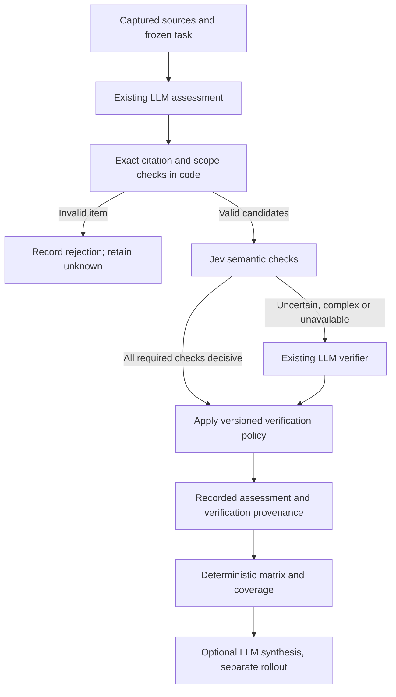

# Jev integration: cheaper evidence verification and stronger comparison reports

Status: **Stage 0a measured; stages 0b and 0c implemented. Cheaper-verifier quality: NOT_VALIDATED. Jev remains proposed.** Written on 2026-10-19 after inspecting the current working tree, and reviewed against the code the same day (§1.1). The implementation update and measured baseline are in §1.2. This document extends [new_simulation.md](new_simulation.md), especially §§3.4–3.5, 6 and 9. Jev adapters, events, calibration and synthesis below remain proposals.

**Review outcome:** the cost premise holds, but a cheaper verifier model already supported by the gateway captures nearly all of the saving with a fraction of the work. Jev should be pursued only if that route fails on quality, and then mainly as a quality experiment. See §1.1 and the revised delivery sequence in §10.

## 1. Decision and scope

Add Jev alongside the existing LLMs as an optional decision service. Start with semantic verification of comparison assessments. Keep the current LLM assessment call and use the current LLM verifier as a fallback. Evaluate this change independently from an optional final comparison-writing step.

The intended benefits are:

- Reduce expensive generative judge calls for bounded evidence checks.
- Preserve or improve detection of unsupported claims without discarding valid findings.
- Spend analysis allowance on useful evidence and explanations instead of repetitive verification.
- Produce a clearer final comparison through a separate, evidence-grounded LLM synthesis stage.

These are hypotheses. Lower price per token does not establish lower end-to-end cost, and a second model does not establish greater accuracy. Report quality depends on task design, access, captured evidence, assessment and presentation as well as model choice.

The first integration does not change persona navigation, social activity, opinions, task allocation, browser permissions or success rules. Those are behavioral policies; changing them requires the calibration and validation described in the simulation design. Arithmetic, citation identity, eligibility, coverage and permissions remain deterministic code.

### 1.1. Review findings (2026-10-19)

At the original review, all dollar figures were estimates from code limits and [llm/prices.ts](../simulation/src/llm/prices.ts), and no comparison run existed in the local project stores. The original estimates remain in §7; the subsequent real pilot is recorded separately in §1.2.

1. **Verification is a real share of comparison cost, but Jev can reach only that share.** With default Anthropic routing, verification is roughly 40% of an episode's cost and assessment roughly 50%. Jev does not touch assessment, so even a perfect cascade saves at most about 40% of comparison spend.
2. **A cheaper verifier model is the baseline that has to be beaten.** Routing the existing verifier to the navigator's model (Haiku 5.5 in the default routing) costs about $0.003 per episode, against $0.058 today. A Jev cascade costs $0.001 plus fallback, and beats that route only when whole-episode fallback stays below about 3%. Both routes need the same labelled evaluation. The cheap-model route needs no new provider, credential, event type or calibration artifact.
3. **Whole-episode fallback compounds.** With `n` required checks that are each decisive with probability `p`, the fallback fraction is `f = 1 − pⁿ`. Five criteria × three checks plus two outcome checks at 95% gives `f ≈ 58%`, not the 20% illustrated in the original §7. Fallback episodes also pay Jev and LLM latency one after the other.
4. **Some verifier spend is avoidable in code today, independent of any model change:**
   - In `assessEpisode()`, `citationRejection()` and the evidence rule are applied *after* the verifier. The verifier is therefore paid to review items that code rejects anyway.
   - `buildComparison()` drops `unknown` labels when it computes a cell. An evidence-free `unknown` cannot change a matrix label; reviewing it affects only its summary text and the `assessed` count.
   - The outcome review matters only when the outcome transition rules would apply the proposed outcome. A `blocked_environment` terminal result, for example, is never replaced.
   - When nothing that can change remains, the verifier call can be skipped.
5. **The two judge calls do not share a cache.** Assessment and verification send the same ~20–25k-token packet, but behind different system prompts that come first. The gateway places cache breakpoints only on system blocks, so the packet is billed in full twice. This matters only if the verifier stays on the judge model.
6. **Baseline cost can already be measured.** `llm.call` records `purpose` (absent in older logs), so one real comparison run gives the actual assessment, verification and navigation split (query in §7).
7. **Jev's stronger argument is quality, not cost.** Splitting a judgment into small typed checks may detect unsupported claims better than one prose review. That is worth testing offline. Note, though, that fixed reason codes produce less informative rejection reasons in the report than LLM prose (§4.3).
8. **External claims were not re-verified in this review.** Jev pricing, limits and the citation pattern are as checked on 2026-10-19 above. In particular, confirm whether the shared state is billed once per request or once per question. §3 notes that the 32k per-question limit includes the state; per-question billing would multiply the cost of a batch, though it would still cost cents.

### 1.2. Stage 0 implementation and real baseline (2026-10-19)

The requested implementation is limited to stages **0a–0c**. No Jev provider, API key, cascade or synthesis was added. The optional cheaper route has implementation coverage; its quality gate in §10 remains **NOT_VALIDATED**.

**0a — measured before changing the runtime.** One real comparison used baseline commit `b8b0f66`, seed `20261019`, the built-in persona, four public ATS pricing sites (Workable, Lever, Ashby and Teamtailor), the drafted research task with four criteria and a maximum of 12 steps per target. The model allowance was $1. The saved provider was DeepSeek, so navigation used `deepseek-flash` and both analysis passes used `deepseek-v4-pro`. Full workload, returned usage totals and results are in [the baseline record](benchmarks/comparison-verifier-2026-10-19.json).

| Call purpose | Calls | Recorded cost | Share |
| --- | ---: | ---: | ---: |
| `step` | 39 | $0.07994520 | 21.6% |
| `comparison_assessment` | 4 | $0.150571432 | 40.8% |
| `comparison_verification` | 4 | $0.138881952 | 37.6% |
| **Total** | **47** | **$0.369398584** | **100%** |

All 47 calls succeeded and reported complete usage, with no retries. Costs use returned usage, including cache tokens, and the repository's price table; they are not an invoice. All four target episodes were attempted and assessed, but one ended `task_failed` and three `incomplete`; no task completion was established. Verification's **37.6%** share supports the roughly 40% cost premise for this workload. It does not establish Anthropic costs, successful study quality, or savings from the optional route.

The local `test-results/comparison-baseline/baseline.gnomi` project retains the frozen configuration, captured sources, call transcripts and report. Reproduce the split with the SQL in §7, restricting to `run_id = 'r-0001'` for that project. The local pilot runner is `test-results/comparison-baseline/run.ts`; it uses a provider key supplied at execution, not embedded in the saved project or this record.

**0b — trim before review.** `assessEpisode()` now rejects out-of-task and duplicate criteria, invalid citations, forbidden evidence bases and unsupported evidence-free findings before dispatch. Only eligible criteria and outcome transitions are proposed for review; when neither remains, no verifier step is admitted or called. The evidence packet, semantic decision rules, assessor provenance, rejection reasons and last-action success handling are preserved.

Evidence-free `unknown` proposals remain in the event log with the explicit rejection `Evidence-free unknown retained without semantic verification.` Their unreviewed summary is excluded from the report and they do not increment its assessed count. Evidence-backed unknowns and `not_applicable` proposals still receive semantic review. Historical recorded assessments keep their original interpretation.

**0c — optional model route.** Set `comparison.execution.verifier` to `navigator`, or select **Evidence verifier → Navigator model (experimental)** in comparison setup. Omission or `judge` retains the existing model. The verifier keeps the judge role's sampling settings, prompt, schema and limits; only its model route changes. The frozen run settings, estimate, matched-block and per-call admission, and report/export limitations use the selected route. Assessment and verification costs are learned separately by call purpose. Roll back for new runs by selecting `judge` or omitting the setting.

## 2. Baseline implementation (before stages 0b–0c)

| Responsibility | Existing implementation | Implication |
| --- | --- | --- |
| Provider routing | [settings.ts](../simulation/src/settings.ts), [llm/gateway.ts](../simulation/src/llm/gateway.ts), [seams.ts](../simulation/src/seams.ts) | The five generative roles are navigator, socialiser, persona_writer, judge and author. Jev should not become a selectable substitute for every role. |
| Product interaction | [agent/loop.ts](../simulation/src/agent/loop.ts), [poi/](../simulation/src/poi/) | Web steps ask the navigator to interpret observations and propose an action. Text and design inputs have their own runners. |
| Comparison execution | [comparison/runtime.ts](../simulation/src/comparison/runtime.ts), `createComparisonRuntime()` | Matched tasks run with target-specific context and captured sources. Comparison mode disables ordinary social rounds and uses its own evidence analysis. |
| Evidence packet | `comparisonPacket()` in the comparison runtime | Deduplicates by source ID, samples at most 24 distinct sources, limits source text and trace entries, and declares omissions. |
| Assessment | `assessEpisode()`, purpose `comparison_assessment` | A generative judge proposes an outcome, reasons, criterion labels, summaries and exact citations. |
| Verification | `assessEpisode()`, purpose `comparison_verification` | A second generative judge, on the same judge model, checks the proposed outcome and every proposed criterion against the rubric and captured evidence. It receives the same packet as the assessor plus the proposal, behind a different system prompt, so no cache is shared between the two calls. |
| Exact validation | `citationRejection()` and [report/comparison.ts](../simulation/src/report/comparison.ts) | Code checks source identity, quote membership, scope and allowed evidence basis. At runtime these checks are applied after the verifier call, not before it. Report projection repeats validation. |
| Comparison report | `buildComparison()` in the comparison report module | Builds the matrix, conditional shortlist, fit, coverage and actions from recorded events, with no model calls. Summary/action wording is currently constructed in code. |
| Legacy report writing | [report/models.ts](../simulation/src/report/models.ts), `runReportModels()` | Groups and names themes, then writes suggestions. [run.ts](../simulation/src/run.ts) skips this pipeline for explicit comparison studies. |
| Cost and admission | `spentUsd()`, `budgetedLlm`, `beginComparisonBlock()` in `run.ts`; [llm/estimate.ts](../simulation/src/llm/estimate.ts) | Recorded costs currently come from `llm.call`, which records `purpose`, so cost can be split by assessment, verification and navigation. Comparison admission estimates navigation plus two judge passes per target, both priced at the judge model. Reservations are approximate, not a hard bound on billing. |

The distinction between the two report paths matters. Connecting Jev to the legacy report judge will not improve the explicit comparison path. Likewise, the existing legacy author prompt is not a suitable comparison synthesizer: it is written to suggest changes to a product's usability themes.

## 3. Jev capabilities relevant to this design

Jev accepts state and typed questions, returning decisions and probability information. It does not generate the explanations needed by the current assessment schema. Use it for narrow classifications, with code controlling their consequences. [Official System One documentation](https://docs.typesafe.ai/concepts/system-one).

As checked on 2026-10-19, the official model reference lists `jev-1.13.0` and `jev-1.14.0` at $0.042 per million input tokens, with output free. Default limits are 64k tokens per request and 32k per question, including the state. It lists `jev-latest` pointing to 1.13 and `jev-preview` to 1.14. Pin an evaluated version; record the returned version and re-evaluate upgrades. Do not rely on alias names to reproduce results. [Model reference and pricing](https://docs.typesafe.ai/models).

Use the direct TypeSafe API initially: `POST https://api.typesafe.ai/v1/systemone`, authenticated through the secret store. Question keys are response identifiers, not instructions seen by the model, so each question must explicitly identify its subject in its instructions. [API reference](https://docs.typesafe.ai/api).

Independent checks over shared evidence can be batched in one request. A question cannot depend on another answer from that same request. [Parallel-question pattern](https://docs.typesafe.ai/patterns/fan-out).

Start with text evidence. The image documentation describes image and Box support as experimental, while introductory pages still describe text-only support. Image navigation is outside this proposal. [Image support status](https://docs.typesafe.ai/images).

Jev confidence summarizes its answer distribution; it is not a measured probability that a Gnomi finding is correct. Choose thresholds using held-out labels, separately for different questions and consequences. [Confidence documentation](https://docs.typesafe.ai/confidence). The provider documents limitations involving numerical precision, indirection, irrelevant context, option ordering and adversarial content for 1.13. Include these in evaluation rather than assuming typed answers are correct. [Documented limitations](https://docs.typesafe.ai/model-jaggedness/jev-1.13).

## 4. First integration: comparison verification

### 4.1. Execution flow



Insert the policy after the existing `comparison_assessment` response and before the existing `comparison_verification` call in `assessEpisode()`. Extract verification orchestration into a proposed `comparison/verify.ts`; keep runtime scheduling and source capture in `runtime.ts`.

Run cheap structural checks before Jev: allowed criterion ID, unique criterion, required evidence, source identity, exact quotation and evidence-basis restrictions. Invalid items remain recorded as rejected. Do not ask either model to repair or reinterpret a fabricated citation. Preserve the current outcome transition rules, including handling of blocked episodes and success confirmed after the last allowed action.

### 4.2. Questions and evidence

Construct stable internal claim IDs from the episode and criterion; give the outcome its own ID. A criterion may need multiple atomic checks. For example:

| Check | Suggested answer space | Purpose |
| --- | --- | --- |
| Does the cited context support this proposition? | `supports`, `contradicts`, `insufficient` | Detect unrelated or contradictory quotations. |
| Does the evidence justify this basis? | `supported`, `unsupported`, `uncertain` | Prevent a marketing assertion or simulated interpretation becoming observed workflow performance. |
| Does the proposed assessment follow this criterion's rule? | `supported`, `unsupported`, `uncertain` | Distinguish an evidenced mismatch from absence of information. |
| Does the trace satisfy the declared success rule? | `supported`, `unsupported`, `uncertain` | Prevent a navigator's declaration of completion from becoming proof. |
| Did the episode materially replace the assigned task? | `yes`, `no`, `uncertain` | Detect invented accounts, invitations, candidate data or assignments. |

Use explicit rubrics with boundary cases. Keep exact price calculations, seat comparisons and dates in code after values are reliably extracted; escalate complicated interpretations. Unknown assessments can be valid: the question is whether the recorded uncertainty is justified, not whether the underlying capability is present.

Provide the frozen target, scenario, task, criterion rule, proposed claim and basis, exact citations, surrounding source context and relevant trace. Include captured contrary evidence, not only the quote selected by the assessor. Retain the evidence packet's omissions and truncation warnings. A narrow packet cannot prove that no contrary evidence exists elsewhere.

Batch independent checks within an episode where context limits permit. Keep persona and target scope explicit. Split oversized requests into deterministic chunks, record chunk membership, and merge by claim IDs. Count repeated input across chunks in cost estimates. Missing answers or incomplete chunks cannot count as support.

TypeSafe's [citation-checking example](https://docs.typesafe.ai/cookbooks/citation_check) demonstrates the relevant separation: code establishes whether a quote exists, and semantic judgment establishes whether its context supports the claim. Gnomi must additionally enforce its task, scenario, scope and evidence-basis rules.

### 4.3. Routing and reasons

Support three frozen modes:

- `off`: the existing LLM verifier is authoritative; no Jev requests.
- `shadow`: retain the existing verifier's decisions and record Jev's output for evaluation only.
- `cascade`: apply the evaluated Jev policy to decisive cases and fall back to the existing verifier when required.

For the initial cascade, fall back for the **whole episode** if any required check is ambiguous, malformed, missing, contradictory across checks, outside the validated scope, or affected by an API failure. This keeps the existing whole-episode verifier contract intact. Count fallback per episode, not per question. Partial fallback can be evaluated later as a separate policy.

Acceptance requires every required check to pass both its semantic condition and its calibrated threshold. Confident unsupported decisions may reject an item only after their false-rejection behavior has been validated. Complex outcome judgments can remain permanently routed to the LLM until their Jev route passes evaluation. An API failure is an unavailable check, never a negative finding about a product.

If fallback cannot run because of a stop, deadline or allowance, keep affected judgments unverified/unknown. Do not silently lower a threshold, reuse a different persona's verdict or accept the proposal without review.

The existing `comparisonVerificationSchema` requires prose reasons. Jev does not supply those. Introduce an internal normalized verification result with structured reason codes such as `citation_unrelated`, `source_contradicts_claim`, `basis_not_supported`, `rubric_not_satisfied`, `uncertain` and `verification_unavailable`. Code may render fixed factual explanations from those codes. Preserve LLM-authored explanations for fallback results, clearly attributed. Do not manufacture Jev reasoning text.

## 5. Adapter, configuration and recorded contracts

### 5.1. Separate decision port

Add a `DecisionGateway` interface to [seams.ts](../simulation/src/seams.ts), backed by proposed `decision/types.ts`, `decision/jev.ts` and `decision/scripted.ts` modules. Use runtime validation at the adapter boundary. This is a proposed application contract, not an SDK signature:

```typescript
type DecisionRequest = {
  operation_id: string;
  run_id: string;
  episode_id: string;
  purpose: 'comparison_verification';
  model: string;
  state: unknown;
  questions: DecisionQuestion[]; // application-owned, validated question union
  signal: AbortSignal;
  timeout_ms: number;           // includes queueing and retries
};

interface DecisionGateway {
  evaluate(request: DecisionRequest): Promise<DecisionResult>;
}
```

`DecisionResult` should expose answers by question ID, probability distributions, supplied confidence, actual response model, usage status and attempt references. Validate finite values, probability ranges, expected labels and exact question coverage. Never turn absent usage into known zero cost.

Use the direct HTTP adapter with bounded retries, cancellation and TypeSafe-specific rate limiting. If the official SDK is adopted instead, pin it and disable hidden retries so every attempt is accounted for. Keep SDK imports in the adapter; simulation policy depends only on the port.

Leave `ProviderId`, `ModelChoice` and the five generative roles scoped to generative models. Introduce a separate decision-provider configuration. Credential UI types may need a broader union, but that must not expose Jev in navigator/author dropdowns. Reuse the credential vault and transport conventions.

### 5.2. Frozen configuration

Add an optional versioned verification configuration under comparison execution settings in [comparison/types.ts](../simulation/src/comparison/types.ts); validate it in [comparison/config.ts](../simulation/src/comparison/config.ts). Omitted settings mean `off` for existing projects. Freeze the resolved configuration in the run snapshot.

Fields should include mode, provider, pinned model, policy version, question/rubric versions, validated scope, calibration-artifact ID, per-check thresholds, input limits, request timeout, retry limits and fallback route. Resolve the fallback to the existing judge model at run creation and record it. Keep final synthesis independently configurable and disabled initially.

No universal threshold is specified here. A cascade configuration without a suitable calibration artifact should fail validation before execution; it may still be run in shadow mode. Thresholds and routing must not change silently during a study.

### 5.3. Provenance and replay

Add two distinct recorded concepts:

1. **`decision.call` attempt telemetry:** operation/attempt IDs, purpose, episode and persona/target association, provider, requested and returned model, queue/latency, status, usage, recorded cost, cost uncertainty and redacted transcript reference. Include paid failed attempts and retries.
2. **`comparison.verification` logical result:** proposal reference/hash, claim IDs, cited event references, question/rubric/policy versions, Jev distributions and confidence, thresholds used, fallback reason and attempt references, final route, per-item verdicts and reason codes.

Record verification before the accepted/rejected assessment that references it. Existing `comparison.assessment.assessor` identifies the proposer; do not overwrite it with Jev or imply that it describes both passes. Link the outcome verification from the episode's final result as well as criterion verification from assessments.

Persist the exact bounded request and question definitions, not just their hashes. Keep credentials out of transcripts and exported settings, using existing redaction conventions. New-version projections validate the recorded verification links and scope. Legacy logs without those fields retain their existing interpretation and are labeled accordingly.

Report rebuilds consume recorded decisions without calling Jev or reapplying newer thresholds. Reassessment creates a separately versioned analysis; it must not overwrite the old report's evidence history. No general replay CLI is assumed to exist today.

## 6. Integration map

| Location | Planned change |
| --- | --- |
| [simulation/src/seams.ts](../simulation/src/seams.ts) | Add the decision port and `typesafe_api_key` secret name. Keep provider SDK types out of the port. |
| `simulation/src/decision/{types,jev,scripted,prices}.ts` — new | Typed decisions, HTTP adapter, scripted fixtures and dated TypeSafe pricing. |
| `simulation/src/comparison/{verify,verification-prompts}.ts` — new | Atomic checks, batching, response normalization, shadow/cascade policy and fallback orchestration. |
| [comparison/runtime.ts](../simulation/src/comparison/runtime.ts) | Inject the decision port; call verification orchestration after assessment; record provenance and preserve current outcome transitions. |
| [comparison/prompts.ts](../simulation/src/comparison/prompts.ts) | Retain the generative assessment and fallback verifier; adapt their output to the normalized verification contract. |
| [comparison/types.ts](../simulation/src/comparison/types.ts), [comparison/config.ts](../simulation/src/comparison/config.ts), [types.ts](../simulation/src/types.ts) | Versioned settings, new events, verification references, report usage fields and compatibility decoding. |
| [run.ts](../simulation/src/run.ts) | Extend `RunDeps`, compose the budgeted decision port, account for both attempt types, and reserve assessment/verification/fallback/synthesis work. |
| [llm/estimate.ts](../simulation/src/llm/estimate.ts) | Estimate baseline, shadow and cascade separately; show generative and decision calls separately and include fallback ranges. |
| [report/comparison.ts](../simulation/src/report/comparison.ts), [report/build.ts](../simulation/src/report/build.ts) | Validate recorded verification provenance, retain unknowns, include combined costs and expose analysis configuration. |
| [engine/src/host.ts](../engine/src/host.ts) | Construct the adapter, inject it into `startRun`, preflight configured credentials, and use scripted decisions in fake-model mode. |
| [engine/src/protocol.ts](../engine/src/protocol.ts) | Extend credential/configuration messages where required; keep secrets out of normal project payloads. |
| [engine/src/cli.ts](../engine/src/cli.ts), [acceptance/run.ts](../simulation/src/acceptance/run.ts) | Explicit TypeSafe environment/config support; instantiate decision adapters and include their calls in evaluation metrics. |
| [app/src/providers.ts](../app/src/providers.ts), [app/src/main/providers.ts](../app/src/main/providers.ts) | Store, mask, remove and test TypeSafe keys using the existing secure vault; separate decision providers from generative routing. |
| [Settings.tsx](../app/src/renderer/src/Settings.tsx), [ComparisonSetup.tsx](../app/src/renderer/src/ComparisonSetup.tsx) | Configure the optional verifier and show frozen analysis mode and estimated cost at setup. |
| [ComparisonReport.tsx](../app/src/renderer/src/ComparisonReport.tsx), [reportFile.tsx](../app/src/renderer/src/reportFile.tsx), [report/markdown.ts](../simulation/src/report/markdown.ts) | Display provenance, limitations and optional validated synthesis consistently across app and exports. |
| [simulation/package.json](../simulation/package.json) | Export only adapter/configuration entry points needed by the host and CLI. Add an SDK dependency only if choosing it over direct HTTP. |

At implementation time, search all consumers of `llm.call`, `cost_usd`, `Report.methods.models`, `SecretName` and provider enums. These cross-cutting integrations cannot be completed by adding a provider switch in `llm/gateway.ts` alone.

## 7. Budget, latency and efficiency accounting

The current run ledger reads only `llm.call`. A separate decision event requires extending every total used for admission, cancellation, persisted run cost, report cost and acceptance metrics. Keep `llm_calls` meaningful and add `decision_calls` plus a combined attempt count; do not silently rename Jev requests as generative calls.

Reserve known conservative cost before dispatch and reconcile returned usage. Include the full state and questions, repeated chunk inputs, retries, and possible fallback. Missing usage retains an uncertain reservation. Unknown pricing cannot substantiate a cost-saving claim. Initial cascade admission should allow for full fallback; do not spend presumed savings before work completes.

Keep one run-wide allowance and deadline. Give TypeSafe its own quota limiter so a TypeSafe 429 does not unnecessarily throttle navigator capacity. All attempts share cancellation. An aborted in-flight request may still be billed. A retry must be individually recorded and re-admitted; disable retries hidden inside an SDK.

Reserve any final synthesis allowance before starting additional matched task blocks. The existing minimum-block estimates are not strict worst-case reservations; implementing Jev must not turn those into an advertised guarantee of total billing.

For `E` fully reviewed episodes and whole-episode fallback fraction `f`, assuming one Jev request per episode and no retries:

```text
Baseline generative judge calls = 2E
Cascade generative judge calls  = E + fE
Additional Jev requests         = E
Judge-call reduction            = (1 - f) / 2

Baseline analysis cost = E × (assessment_cost + verifier_cost)
Cascade analysis cost  = E × (assessment_cost + Jev_cost)
                         + fE × fallback_verifier_cost
```

For 20 personas × 4 targets × 1 task, `E = 80`. At an illustrative 20% fallback rate, generative judge calls fall from 160 to 96, with 80 Jev requests added: 40% fewer generative judge calls, but more total API requests. At 10,000 billed input tokens per Jev request and the cited price, Jev costs approximately $0.0336. This excludes navigation, retries, chunking and final writing, and is arithmetic rather than a benchmark.

The 10,000-token figure is low. `comparisonPacket()` allows up to 24 sources sharing 72,000 characters, plus up to 24 trace entries of 800 characters, so a full packet with its rubric is about 20–25k tokens. The 20% fallback rate is also optimistic under whole-episode fallback: `f = 1 − pⁿ` for `n` required checks that are each decisive with probability `p`. For 17 checks (five criteria × three, plus two outcome checks), `p = 0.95` gives `f ≈ 0.58`, and `p = 0.99` gives `f ≈ 0.16`.

**Estimated cost per episode (review, 2026-10-19).** This uses default Anthropic routing: Sonnet 5.5 judge at $2/$10 and Haiku 5.5 navigator at $0.1/$0.5 per million tokens. It assumes the drafted 12-step research task, a ~22k-token packet, ~2.5k assessment output tokens and ~1k verifier output tokens, with no caching. These are estimates, not measurements.

| Stage | Cost | Share |
| --- | --- | --- |
| Navigation, 12 steps | ~$0.009 | ~6% |
| Assessment | ~$0.07 | ~51% |
| Verification | ~$0.058 | ~42% |

| Verification route | Cost per episode | New work |
| --- | --- | --- |
| Current: judge model | ~$0.058 | none |
| Jev cascade, `f = 0.2` | ~$0.013 | provider, credential, events, configuration, calibration, UI (§6) |
| Jev cascade, `f = 0.58` | ~$0.035 | same |
| Navigator model as verifier | ~$0.003 | one optional execution setting; host preflight already checks the navigator key for comparisons |
| Judge model with the packet cached across both calls | ~$0.029, including the extra cache write | prompt reordering so the packet follows a shared prefix |

A Jev cascade is cheaper than the navigator-model route only while `0.001 + 0.058f < 0.003`, which means `f < ~3%`. At `E = 80`, today's verification is about $4.60 of roughly $11 of comparison spend. Other providers' default routings show a similar judge-to-navigator price ratio. The route choice is therefore a quality question, and both routes need the same labelled corpus (§9).

Measure the real split from one comparison run before relying on these figures:

```sh
sqlite3 -readonly <project>.gnomi/project.sqlite "select json_extract(payload_json,'$.purpose'), count(*), round(sum(json_extract(payload_json,'$.cost_usd')),4) from event where type='llm.call' group by 1"
```

Latency must be measured separately. A fallback episode pays for Jev before its LLM verification. Report p50/p95 stage and run latency, queue time, request count, fallback reasons, usage completeness and total dollars at matched coverage. A faster incomplete study is not an efficiency improvement.

Shadow mode adds cost. Prefer offline shadow evaluation of frozen evidence so its cost and latency cannot consume the baseline study's remaining browser allowance. A live shadow run must declare the extra allowance and cannot claim to be budget-equivalent to the baseline.

## 8. Better final reports: a separate implementation stage

The comparison report currently uses deterministic wording and does not call `runReportModels()`. Add a dedicated proposed `report/comparison-models.ts`, rather than enabling the legacy author path indiscriminately.

After episode assessments are frozen and `buildComparison()` has produced the validated matrix, the configured author LLM may write:

- A conditional recommendation scoped to the scenario, segment and access actually tested.
- The decisive supported differences, shared strengths and unresolved must-haves.
- Up to three owner-appropriate actions with evidence, a hypothesized benefit and a validation step.

Provide the matrix, coverage, accepted propositions, contrary evidence, scoped fit and limitations. Require structured output with references to existing cells and evidence IDs. Every comparative claim must cite support for both sides. The writer cannot alter computed outcomes, fit eligibility, denominators, criterion importance or invent an overall winner.

Validate IDs and scope in code. Optionally evaluate semantic claim checking with Jev under a separately calibrated policy, escalating ambiguity to the LLM verifier. Record synthesis and its review as versioned events; the final projection consumes those events without new inference. If writing or review fails, retain the deterministic summary, actions, matrix and limitations. Bound any repair attempt and include it in the allowance.

Keep this feature independent from verification routing so evaluation can compare:

1. Existing verification and deterministic report.
2. Jev cascade and deterministic report.
3. Existing verification and validated LLM synthesis.
4. Jev cascade and validated LLM synthesis.

This separates savings from improved writing. It also avoids attributing a clearer report to Jev when the improvement came from the new author stage. Jev confidence must never be presented as human agreement, purchase probability or statistical confidence in a product conclusion.

## 9. Evaluation and acceptance

Use the comparison failure cases in [new_simulation.md §9](new_simulation.md#9-scientific-evaluation-and-acceptance) as the starting fixture set. Add a dedicated verifier evaluation module under `simulation/src/acceptance/`; existing social/defect benchmarks alone do not validate semantic verification.

### Required fixtures

| Case | Required behavior |
| --- | --- |
| A quote exists but discusses candidate profiles while the claim concerns pricing | Reject semantic support despite exact text membership. |
| A blocked documentation host or missing account is described as a missing feature | Retain the access limitation; do not accept capability absence. |
| Public marketing copy is presented as demonstrated workflow performance | Reject the claimed basis. |
| A lower-priced tier excludes the stated company size | Preserve eligibility; do not conclude it is the applicable cheapest option. |
| The navigator invents an invitation or a different task | Preserve invalid-task handling and exclusions. |
| The task succeeds on its last permitted action | Require captured success evidence; preserve the runtime's terminal rules. |
| Sources conflict or a relevant contrary source is outside the supplied packet | Preserve conflict/coverage uncertainty; do not infer absence of contradiction. |
| Valid findings are concise, unusual, multilingual or phrased negatively | Measure false rejection as well as false acceptance; escalate outside validated scope. |
| Source text attempts to instruct the verifier | Treat it as evidence data; test adversarial resistance explicitly. |
| A response omits a question, adds an unknown label or supplies invalid probabilities | Reject the response and follow fallback policy. |
| API timeout, 429, missing usage, cancellation or exhausted fallback allowance | Account for every attempt; no unverified acceptance or fabricated product failure. |
| Replay, older runs and disabled mode | No network calls during projection; existing semantics remain compatible. |

Build a human-labeled corpus of captured episodes with adjudicated supported/unsupported/uncertain judgments. Split calibration and held-out evaluation by study/target/source family to avoid nearly identical captures appearing in both. The existing LLM verifier is a baseline, not ground truth. Audit high-confidence agreements as well as disagreements.

Measure unsupported-claim acceptance, valid-claim rejection, outcome errors, coverage, escalation rate, calibration by check type, and performance by scope and language. For final reports, use blinded reader review of factual support, usefulness, ownership of actions and visibility of unknowns. Record reviewer agreement and adjudication.

Freeze acceptable quality margins, efficiency targets, sample sizes and spending allowance after a pilot and before confirmatory evaluation. Use study/run-level paired uncertainty estimates rather than treating repeated claims from the same source as independent. Until evidence exists, report `NOT_RUN`, `NOT_VALIDATED` or `INCONCLUSIVE` as appropriate. Agreement between two AI models is not human behavioral validation.

Automated implementation checks should cover adapter contracts, routing, accounting, provenance, deterministic rebuilds and export parity. Use scripted gateways and fake HTTP responses; they require no paid model calls. Relevant existing suites include `comparison/runtime.test.ts`, `comparison/config.test.ts`, `report/comparison.test.ts`, `run.test.ts`, provider tests and report export tests.

```sh
npm test -w @gnomi/simulation
npm run typecheck -w @gnomi/simulation
# After engine/app integration:
npm test
npm run typecheck
npm run smoke:comparison -w @gnomi/app
```

These are implementation validation commands, not evidence that the proposed model route saves money or improves real decisions. A live pilot needs configured credentials, a fixed workload and an explicit allowance.

## 10. Delivery sequence

| Stage | Deliverable | Exit condition |
| --- | --- | --- |
| 0a. Measure | One real comparison run; cost split by `llm.call` purpose (§7 query) | Actual assessment, verification and navigation shares replace the estimates in §1.1 and §7. |
| 0b. Code-only verifier trimming | In `assessEpisode()`: apply exact checks before the verifier; send only criteria whose verdict can change a recorded result; review the outcome only when the transition rules would apply it; skip the call when nothing remains | Existing rejection reasons, provenance and outcome transitions are unchanged except for the documented evidence-free-unknown choice; runtime tests cover a skipped call and items that are not sent. |
| 0c. Cheaper verifier route | Optional `execution.verifier: 'judge' \| 'navigator'` (omitted means judge) in comparison configuration, used by the runtime, the estimate and admission, and disclosed in the report | The navigator-model verifier matches the judge verifier on the §9 fixtures and the labelled corpus within predeclared margins. If it does, stop here: stages 2–4 are not needed for cost. |
| 1. Baseline and fixtures | Frozen episode packets, human labeling rubric, baseline costs and verification results | Enough representative evidence to calibrate and evaluate independently. Shared with stage 0c. |
| 2. Adapter and accounting | Only if stage 0c fails on quality, or Jev is pursued for quality: decision port, HTTP/scripted adapters, credentials, events, configuration and combined ledger; default `off` | Scripted contract, budget, cancellation and compatibility checks pass. |
| 3. Offline shadow | Same frozen packets reviewed by the LLM verifier, the cheaper verifier route and Jev; recorded probabilities, failures and costs | Thresholds and routing selected on calibration data; held-out quality/efficiency decision documented against stage 0c, not only against the judge verifier. |
| 4. Opt-in cascade | Jev verification with whole-episode LLM fallback and frozen policy | Predeclared quality margins and efficiency criteria pass for a named scope, with a measured fallback fraction low enough to beat stage 0c on cost (§7). |
| 5. Comparison synthesis | Dedicated evidence-grounded writer and recorded claim review | Supported recommendations and export parity pass; blinded usefulness evaluation improves over the deterministic report. |
| 6. Optional optimizations | Criterion-aware evidence selection or other bounded checks | Each change has its own quality and cost evaluation. |

Criterion-aware evidence selection is a later experiment because it changes what assessors can see. Preserve exact source identity, contrary evidence, selected/omitted IDs and the complete stored captures. Benchmark evidence recall and unsupported conclusions, not just token reduction. Reusing a source across personas does not make it independent corroboration.

Defer Jev-controlled navigation, social attention, memory pruning and persona opinions. They may eventually reduce generative work, but they also change the simulated population's behavior and require separate model versions and behavioral validation.

Rollback is configuration-based for new runs: set verification mode to `off` and optionally disable synthesis. Keep existing recorded Jev decisions readable and retain their original policy/version labels. Historical runs must not be silently reinterpreted after rollback.
