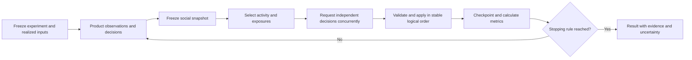

# Proposed simulation: scientific experiments in a contained runtime

Status: **Steps 1 to 6 of §10 are implemented on branch `claude/simulation-workspace`; phase 2 (§8) and review decisions 2 and 3 (§10) remain.** Written on 2026-10-18 against baseline commit `9e383901046046eb9d6e06853f3a0aaf86504a4b` and revised after two reviews. The branch has the `simulation/` workspace (step 1), heard-post ids and first-hand counts (step 2), ordered social phases, feed positions, seeded ties, per-role temperature and the prior-opinion influence rule (step 3), graph metrics and null networks (step 4), the evaluation harness (step 5) and the ODD description in [odd.md](odd.md) (step 6). The run store and protocol (phase 2) are not built, the first validation task and benchmark are not chosen, and no behavioural validation has been done. The baseline before the move is documented in [old_simulation.md](old_simulation.md). Sections below keep the original design wording where it still describes the design.

## 1. Objective and scope

Build a simulation runtime that produces inspectable product-research experiments: what a defined synthetic population experienced, what it communicated, how its responses varied, and what evidence supports the resulting findings. Improve behavioral validity and computational efficiency through measurement. A convincing conversation, a larger audience, or a scientific library is not evidence of validity by itself.

The intended consumer remains Gnomi's desktop app, with a headless runner for experiments and evaluation. The runtime covers product interactions, social interaction, observations, decisions, opinion state, evidence, and run-level analysis. Editable projects, imports, credentials UI, and report presentation remain application concerns.

The proposed boundary is a top-level `simulation/` npm workspace named `@gnomi/simulation`, with its own dependencies, tests, fixtures, public contracts, and standalone Node entry point. Initially the desktop composes it inside the existing engine utility process; it is already separate from the UI process. Headless execution runs it independently. This provides a service boundary without adding a second worker hop to every desktop request. A network service can use the same contracts later; HTTP hosting, authentication, multi-tenancy, Redis, and distributed workers are outside this first design.

Success has separate dimensions: implementation correctness, reproducible recorded execution, agreement with relevant human evidence, robustness to assumptions, and measured cost/time. A release can satisfy some dimensions and remain unvalidated on others.

## 2. Ownership and dependency boundary

| Owner | Responsibilities |
| --- | --- |
| `simulation/` | Frozen experiment/run contracts; population snapshots; runtime scheduling; product and social decisions; graph/feed/exposure state; memory and opinion policies; model budgets; run persistence; replay; deterministic metrics; optional evidence-grounded report analysis. |
| `engine/` | Project and audience editing/authoring; Figma and asset import; login recording; translation of existing project settings into simulation requests; legacy event/report readers; presentation/export helpers. |
| `app/` | Electron lifecycle, OS credential storage, user controls, visualization, and report presentation. |
| Simulation adapters | Browser execution and containment, provider requests, storage, clocks, and transport. Adapters implement interfaces owned by the simulation package. |

Dependencies point from `app/` and the engine compatibility facade into the simulation's public exports. No simulation source imports `app/` or `engine/` internals. Core policies do not import Electron, Playwright, provider SDKs, or SQLite. Existing interfaces in [seams.ts](../simulation/src/seams.ts) are useful extraction points, but the broad `ProjectStore` must become narrower run-scoped ports.

Layout, which now exists. Files keep their current names and relative paths, so the move is a `git mv` whose diff is empty apart from import paths, and history follows each file:

```text
simulation/
  package.json                 # an explicit exports map and independent scripts
  src/
    run.ts  safety.ts  types.ts  seams.ts  settings.ts  persona.ts  assets.ts
    cli.ts  acceptance.ts      # the standalone entry points, as today
    agent/  poi/  social/  opinion/  signals/  report/  llm/  browser/
    log/                       # the SQLite and blob adapters behind seams.ts
    acceptance/                # the evaluation harness and its fixtures (§9)
    audience/locations.ts  audience/sample.ts  profile/
    graph/synthetic.ts         # the seeded fixture run, beside the harness
  experiments/                 # versioned study definitions and analysis settings
```

Tests stay beside the code as `*.test.ts`, as they are now. The taxonomy of contracts, runtime, ports and adapters describes what these folders contain; it is not a rename to perform during the move. Rename a folder later only when it outgrows its name.

The `exports` map names each file the engine and the app import, in place of the wildcard. The app's imports were switched to `@gnomi/simulation` paths in the move; the engine keeps no re-export shims. An import-boundary check enforces the dependency direction. [no-electron.test.ts](../engine/src/no-electron.test.ts) is a regular expression over import statements, so a copy in the new workspace that also forbids `@gnomi/engine`, `../engine` and `app/` is a few lines. Match existing TypeScript/ESM conventions, discriminated unions, and runtime schema validation at boundaries.

### Reaching the boundary in two phases

The boundary is reached by moving code first and redesigning storage later. The move is where most of the containment value is; §8's run store and recovery protocol are where most of the cost is.

What the boundary crosses today:

- The engine exports every source file (`"./*": "./src/*"` in [engine/package.json](../engine/package.json)). The app imports 20 different engine modules, 53 times from [types.ts](../simulation/src/types.ts) alone.
- Simulation code reaches back into authoring code, counting source files only: `poi/` imports `assets.ts`, `audience/locations.ts`, `audience/sample.ts` and `profile/schema.ts`; `report/` imports `audience/diversity.ts` and `profile/schema.ts`; `llm/` imports `audience/sample.ts`; `agent/`, `browser/` and `run.ts` import `audience/locations.ts` and `profile/schema.ts`; `social/` and `graph/` import the seeded-sampling helpers in `audience/sample.ts`. Only tests import `log/sqlite.ts` and `log/blobs.ts`.
- In the other direction, `audience/write.ts`, `host.ts`, `cli.ts` and the app's provider test import `llm/`, and five renderer files import `graph/`. Those two folders are shared, so the move has to say where they go (below).

**Phase 1, move with no behaviour change.** Create the workspace and move the files in the layout above with `git mv`. `types.ts` moves whole: `RunConfig` freezes the entire `ProjectConfig`, so the project types are simulation inputs, and a split would only re-export them. `profile/` moves whole too, since the acceptance fixture samples profiles and all three files depend only on moved code. The engine keeps what authors and hosts: `host.ts`, `protocol.ts`, `sessions.ts`, `figma/`, the audience writer and proposer (`audience/index.ts`, `write.ts`, `propose.ts`, `demo.ts`, `diversity.ts`) and the UI readers `graph/index.ts` and `graph/feed.ts`, all importing from the simulation's exports. Two reach-backs need a line each: the pure `similarity` and `MEAN_SIMILARITY` that `report/spread.ts` uses move out of `audience/diversity.ts`, which then imports them; and `run.ts` takes `Pick<ProjectStore, 'events' | 'append' | 'saveTranscript' | 'finishRun'>` as its run-store port, leaving `log/` as the adapter that implements the whole interface. `llm/` moves and is exported, so the audience writer imports the gateway from the simulation; the dependency points the right way. The harness's `../../../gym/` imports keep the same depth. The run's tests ([run.test.ts](../simulation/src/run.test.ts), [run.e2e.test.ts](../engine/src/run.e2e.test.ts)) and the scripted acceptance rehearsals are the parity baseline; tokens and results do not change. The PR is large but mechanical.

**Phase 2, when a headless or hosted runner needs it.** The separate run store, `sim-<UUID>` ids, idempotency keys, checkpoints and the command protocol in §8. A single-user desktop app gains little from them, and they add a second lifecycle owner and a migration.

## 3. Define the model before running it

Use the **ODD protocol** to describe each version of the behavioral model. ODD is a reporting structure, not a certificate that the behavior matches humans. [Grimm et al., 2020](https://www.jasss.org/23/2/7.html)

| ODD element | Required Gnomi definition |
| --- | --- |
| Purpose and patterns | Research question, intended population/environment, outcomes to explain, and known limits. |
| Entities, state, scales | Personas, product inputs, posts, directed ties, experience/memory/opinions; units of logical time and observation. |
| Process and scheduling | Who is eligible to act, what they can observe, phase boundaries, and when effects become visible. |
| Design concepts | Assumed attention, learning, heterogeneity, interaction, and adaptation; which patterns are imposed and which may emerge. |
| Initialization | Population, graph, starting beliefs, environment state, and random-stream allocation. |
| Input data | Data provenance, sampling/weighting, asset versions, calibration evidence, and external environment changes. |
| Submodels | Versioned formulas or decision policies for activation, feed ranking, memory, opinion updates, and action generation. |

Every parameter has a name, unit/range, rationale, provenance, and status: **measured**, **calibrated**, or **assumed**. Keep current graph/feed settings as a named legacy baseline, not universal social constants. Changes to the behavioral policy create a new model version, even when wire schemas remain compatible.

### Experiment contract

Before a confirmatory run, freeze:

- The question, target population, scenario, treatment/control, and the quantity being estimated, such as the difference in task-completion rates between product variants.
- Primary and secondary outcomes; eligible denominators; handling of blocked, invalid, abandoned, or incomplete episodes; exclusions and missing-data rules.
- Population/network generation, model/prompt settings, replicate count or precision-based stopping rule, analysis method, and cost allowance.
- Calibration and held-out validation datasets, baseline comparisons, tolerances, and intended scope of any validity claim.

Exploratory runs may omit a confirmatory hypothesis, but must be labeled exploratory. Save deviations after the experiment starts; do not silently revise the definition to match observed results.

For product A/B comparisons, use matched population/network realizations across the two worlds and independent mutable state. Declare any shared random streams used for variance reduction. Changes to the environment, time horizon, or social policy must be treatment variables or documented deviations. Network exposure and interference belong in the design, not just the analysis. [Aronow and Samii](https://arxiv.org/abs/1305.6156)

## 4. Population and behavioral model

### Population

Consume a frozen, realized population with its generation recipe and data provenance. Reuse the existing audience authoring flow initially; an authored biography is synthetic input, not an observed human record. Evaluation harnesses may prepare several independently sampled populations through the public boundary.

Prefer behaviorally relevant traits: goals, product familiarity, constraints, prior experiences, and task context. Record the evidence for demographic distributions and correlations; marginal quotas alone do not establish a representative joint population. Unsupported combinations and missing reference data stay explicit. Weight outcomes only with documented target-population weights, and show unweighted counts as well.

Evaluate within-segment diversity and subgroup errors. Increasing the number of synthetic personas does not resolve shared model bias. Existing research demonstrates identity flattening in the models and settings studied; Gnomi must test its own population/model combinations. [Wang et al., 2024](https://arxiv.org/abs/2402.01908)

### Social mechanisms

1. **Network formation:** use a directed graph with explicit tie semantics and optional weights. Compare the legacy segment-biased network with null networks. The null that answers whether segment homophily drives spread keeps every persona's out-degree and rewires whom it follows without regard to segment: a degree-preserving rewiring of the realized graph, about twenty lines in-house. Clustered and random generators are secondary controls. Persist the realized graph, not just its seed. Treat dynamic following/trust as later, separately evaluated policies.
2. **Availability and attention:** define whether a persona visits the feed during a logical interval independently of whether it posts. Record activation probabilities, sampled eligibility, and exposure decisions. Quiet readers may still change their opinions.
3. **Feed selection:** rank eligible content using a versioned, inspectable policy. Parameters may include tie strength, relevance, recency, and popularity. Freeze candidate/tie-breaking rules and log actual exposure, including each post's position in the feed shown. Models favour items early in a list, and the current ranking puts the most-reacted posts first, so position and popularity reinforce each other. Order equal-rank posts with a seeded per-persona shuffle rather than event sequence. Keep chronological and no-trending controls. Never infer exposure simply from a follow edge.
4. **Decision:** an active persona receives its own permitted observations, bounded memory, and selected feed. One structured model response may propose a post/reply/reaction/no-public-action plus an opinion update. Silence is a valid social action; failed inference is a different outcome.
5. **Opinion transition:** initially use the frozen LLM decision policy with strict validation of allowed values and supporting evidence. Record before/after state and references to firsthand observations or exposed posts. No update is valid. Do not add an automatic popularity-to-belief conversion or force convergence. Mechanistic alternatives require their own parameter definitions and controlled comparison.
6. **Memory:** retain recent observations plus a bounded summary of older relevant evidence, with source IDs and explicit uncertainty. Summarization policies must be versioned and tested for lost contradictions and invented facts. No global knowledge or access to another persona's private history.

Separate self-reported certainty, evidence quality, and statistical uncertainty. They are different quantities. Model-attributed influence edges describe provenance; estimating an intervention's effect requires a controlled comparison. An effect inside the simulator does not establish a real-world causal effect.

Two details of the current edge rule ([social/influence.ts](../simulation/src/social/influence.ts)) change with the model version. The 0.5 threshold is a no-op with integer sentiment, and a first opinion is measured from zero, so a persona forming its first view after reading counts as moved. The corrected rule requires a prior opinion for an `influence` edge and records a first opinion after exposure as a separate `formed` kind, so a first opinion is never counted as influence.

### Social echo in finding counts

The current report already shows an interval: each theme's "k of n personas" with a 95% Wilson range ([report/themes.ts](../simulation/src/report/themes.ts), `prevalence`). It treats each persona as an independent witness. With social rounds on, that is not true. A persona that reads a post is handed it in its next product step ([agent/loop.ts](../simulation/src/agent/loop.ts), [poi/text.ts](../simulation/src/poi/text.ts), [poi/design.ts](../simulation/src/poi/design.ts)), so a friction reported after reading about it may repeat the post rather than confirm it. Social runs therefore inflate k and narrow the range. The correction must not swing the other way: a rule that discounts real defects in social runs confounds the social-on/off comparison in §9 with the rule itself.

Two things separate the two. First, the engine knows at each product step which posts it handed the persona, but does not log it: a heard post ([agent/prompt.ts](../simulation/src/agent/prompt.ts), `HeardPost`) carries author, text and POI name with no post id, and a step's opinion change cites `post_ids: []` ([agent/loop.ts](../simulation/src/agent/loop.ts)). Carrying the post id through and recording the heard ids on the step and friction events makes exposure before a report a fact of the log and costs about ten lines. Second, the judge tags posts with the friction groups they discuss ([report/models.ts](../simulation/src/report/models.ts)), and `social.feed_viewed` records which posts each persona was shown and when. For each theme:

- A persona counts as **first-hand** when at least one of its reports on the theme precedes the first feed that showed it a post tagged with that theme, or when any of its reports on the theme has `confirmed` or `observed` trust ([report/friction.ts](../simulation/src/report/friction.ts)). A browser signal cannot be an echo of a post, so the discount applies to `reported` frictions only.
- Otherwise it counts as **heard first**. It stays visible beside the share, but not in k.
- Ranking, evidence level and the "2+ personas" rule for top lists use first-hand k. Without judge tags, the report falls back to the recorded heard ids: a `reported` friction logged at a step whose heard posts include one by a persona already in the theme counts as heard first. Without either, the report says it could not separate echoes.

This changes report code and a few event-payload lines, and adds no model calls. It is still a within-run quantity: the range describes this run's personas, not the human population, and the report must keep saying so. Replicate-level intervals (§9) are the measure for comparisons between runs.

Use the same frozen language policy across a comparison. Browser locale, persona language, response language, and translation are distinct inputs and must be evaluated rather than assumed equivalent.

## 5. Logical execution and reproducibility

The initial scheduler uses discrete logical rounds with declared product and social phases. A logical round is not a claim about elapsed human time. Model real time only after defining and validating the mapping.



Assign operation IDs from run, logical phase, round, persona, input, step, and purpose. Allocate reproducible RNG streams by stable identities with a documented derivation/jump policy; record algorithm and stream allocation. Do not consume one global random stream in promise-completion order.

Model sampling is part of the experiment definition. Today the gateway sets no temperature or seed ([llm/gateway.ts](../simulation/src/llm/gateway.ts)), and routing names model aliases such as `claude-haiku-5-5` ([settings.ts](../simulation/src/settings.ts)), so a provider can change both defaults and weights between two runs with the same seed. Request a temperature per role, use dated model snapshots where the provider offers them, pass a provider seed where supported, and record the settings sent, less any the provider reports it ignored, with the model version it reports, in the run manifest. Routes with reasoning enabled (`providerOptions` in [llm/gateway.ts](../simulation/src/llm/gateway.ts)) get no temperature, so they record none. This does not make fresh replicates identical; it makes their variation declared.

Freeze observation inputs for each social phase. Issue independent requests concurrently, save attempt telemetry immediately, stage validated decisions, and apply effects in canonical logical order. Feed tie-breaking uses logical IDs/order. API response speed must not select whose post becomes most recent. Product steps within a persona remain sequential; independent personas may execute concurrently.

This deliberately fixes a baseline hazard: [social decisions](../simulation/src/run.ts) currently append as calls finish, and [feed ranking](../simulation/src/social/feed.ts) uses event sequence as a recency tie-breaker. Identical recorded answers can therefore yield different subsequent exposure when response timing changes.

At budget or deadline boundaries, use a frozen admission order and explicit partial-phase policy. Admit a complete phase cohort when its conservative reservations fit; otherwise stop before that cohort or use a predeclared sampling policy with known inclusion probabilities. Do not silently retain only the fastest responders. Provider failures or a wall-clock stop still produce missing observations and partial results, not an assurance of identical live execution.

Maintain three separate execution modes:

| Mode | Guarantee |
| --- | --- |
| Event replay | Rebuild state and metrics from committed events with zero model/browser/network calls. |
| Recorded-input execution | Run the coordinator with recorded observations and responses; require identical committed logical state, decisions and scientific outcome metrics despite artificial latency and permitted concurrency changes. Operational timing/queue telemetry may differ. |
| Fresh replicate | Make new model/environment requests under the frozen design. Seeds control application randomness; model outputs and live websites may still vary. |

Separate browser contexts do not isolate a shared server database. Controlled product comparisons require resettable fixtures or isolated accounts/data per replicate. Arbitrary shared live websites support weaker claims; record that environment limitation.

## 6. Efficient use of models and computation

Use deterministic code for selection, accounting, legal-action checks, state updates, graph metrics, and evidence aggregation. Use models for interpreting content and proposing behavior where language understanding is required. Benchmark each optimization against the baseline on both cost/time and declared behavioral outcomes.

| Technique | Required safeguard |
| --- | --- |
| Stable shared prompt prefix before persona-specific context | Cache keys include model, prompt/schema versions and content. Measure actual provider cache hits; cache support and minimum sizes vary. |
| Skip work with no new relevant information | Preserve the baseline no-information skip. New activity/attention gates are behavioral changes requiring calibration and ablation; never use posting propensity alone to decide whether someone reads. |
| Smaller models for routine roles, escalation for specified cases | Freeze routing/escalation rules; validate each route and log escalation cost. Do not switch model mid-study silently. |
| Bounded context and structured outputs | Keep evidence IDs, contradictory experiences, and validation. Measure truncation, invalid-output and retry rates. |
| Provider-aware concurrency | Separate browser capacity from model capacity and account/endpoint/model quota groups. Preserve logical ordering and retry accounting. |
| Incremental event projections and feed indexes | Update state from new events; keep replay as the reference implementation and compare projections against it. |
| Reuse frozen assets and deterministic calculations | Scope reuse to exact content/policy versions. Independently sampled outputs remain independent. |
| Batch independent calls or use efficient local serving | Only batch within dependency boundaries. Measure latency, cost and behavior on the actual hardware/model; asynchronous provider batches suit offline evaluations better than interactive dependent steps. |

The current gateway already supports shared prefixes; the [social call](../simulation/src/run.ts) currently supplies only a persona-specific system prompt. Extracting common instructions is an early optimization candidate, not a measured saving.

**Response caching has a narrower role than prefix caching.** Recorded responses are appropriate for replay and deduplicating the same operation. Reusing them across fresh replicates would erase intended variation and must not be counted as new independent evidence. Semantic answer caches across different personas are excluded from the initial design.

One budget ledger covers all model-backed phases, including retries, summarization, judging, and report writing. Reserve conservative request cost before dispatch using known pricing, input bounds and output/reasoning caps; reconcile returned usage, keep unknown charges reserved, and stop admission if a safe estimate cannot be made. Record setup cost separately and include it in end-to-end comparisons when population authoring is part of the experiment. Keep deadlines active through final analysis. Cancellation prevents new work but cannot guarantee that an already dispatched request will not be billed.

Measure calls, tokens, cache usage, retry reasons, queue wait, model latency, active browsers, projection time, peak memory, recorded cost and cost uncertainty. Report setup, execution and analysis separately. No speedup claim is accepted without a reproducible workload and a behavioral non-inferiority comparison.

## 7. Libraries and adoption decisions

These are proposed choices, not installation instructions. Pin compatible versions and lockfile at implementation time after checking Node/Electron support, licensing, maintenance, deterministic behavior, bundle/native requirements, and a small integration benchmark. Keep library-specific objects behind public JSON contracts or internal adapters.

| Library | Proposed role | Decision and limit |
| --- | --- | --- |
| [Vercel AI SDK](https://ai-sdk.dev/docs/introduction) and [Zod](https://zod.dev/) | Provider adapters and structured input/output validation. | Keep the existing stack. Simulation policies and quota/budget semantics remain ours. |
| [Graphology](https://graphology.github.io/standard-library/) with [metrics](https://graphology.github.io/standard-library/metrics.html) and [generators](https://graphology.github.io/standard-library/generators.html) | Graph representation, assortativity and degree measurements, clustered/random secondary controls. | **Adopt for metrics.** The app already depends on it, so this moves an existing dependency into the runtime. Its generators give Erdős–Rényi and clustered graphs, not the degree-preserving rewiring that is the primary null (§4); that stays in-house. Use supported seeded RNG hooks; generators do not provide calibrated human networks. |
| [simple-statistics](https://simple-statistics.github.io/docs/) | Run-level mean, variance, quantiles and bootstrap resampling of whole replicates. | **Adopt in the evaluation layer only.** ESM, typed and maintained. It has no Student t quantile, which a handful of replicates needs in place of z; a thirty-row table of 95% t quantiles is one array beside it. jStat would supply the quantile but is UMD, typed through a separate package and barely maintained, so it is not adopted. The Wilson function in the report stays hand-written. Library functions do not decide the unit of inference. |
| Node SQLite and existing Playwright integration | Local durable runs, contained browser interaction. | **Keep** and adapt; preserve host restrictions, observe-only rules, login handling and evidence capture. |
| [graphology-communities-louvain](https://graphology.github.io/standard-library/communities-louvain.html) | Optional community diagnostics. | **Later**, when an evaluation reads community diagnostics. Fix resolution/RNG; an algorithmic community is not automatically a real social group. |
| [p-queue](https://github.com/sindresorhus/p-queue) | In-process execution queues, concurrency and cancellation plumbing. | **Not now.** The run's `inParallel` is about 15 lines and covers today's needs. Revisit if concurrency should rise again after a throttle. It would not implement token quotas, billing reservations or deterministic order in any case. |
| [Promptfoo](https://www.promptfoo.dev/docs/usage/node-package/) | Development/evaluation tool for prompt/model comparisons and custom assertions. | **Not now.** It brings its own provider layer, which would bypass the gateway and allowance ledger. Extending the existing acceptance harness is cheaper. |
| [pure-rand](https://github.com/dubzzz/pure-rand) | Reproducible PRNG and stream allocation. | **Skip.** The engine already derives an independent stream per stable key with `fnv1a` and `mulberry32` (for example `follows/<seed>` in [social/graph.ts](../simulation/src/social/graph.ts) and `profile/<seed>/<segment>/<attribute>` in [profile/sample.ts](../simulation/src/profile/sample.ts)). Document that allocation instead; switching generators changes every saved realization for no scientific gain. |
| A tokenizer such as js-tiktoken | Exact token estimates. | **Skip.** Estimates only gate admission and rate buckets; actual usage comes back from providers. Reading provider rate-limit headers would improve the limiter more. |

[OASIS](https://github.com/camel-ai/oasis) is a reference for social actions and recommendation mechanisms. [Concordia](https://github.com/google-deepmind/concordia) is a reference for component-based agents, memory and environment resolution. Both would add Python integration if adopted wholesale. Study or benchmark selected mechanics first; neither framework establishes Gnomi's validity or performance.

[vLLM](https://docs.vllm.ai/en/latest/) is an optional deployment experiment for open models using continuous batching and prefix caching. Keep it outside the runtime dependency set and compare total hardware/hosting cost and measured quality. A generic agent orchestration framework or vector database is not an initial requirement; introduce one only for a measured capability gap.

## 8. Portable API, persistence and recovery

This section is phase 2 (§2): build it when a headless or hosted runner needs it, not as part of the move.

### Public contract

Use versioned JSON request/response and event schemas shared by the desktop adapter and standalone runner. Internal ports may contain callbacks or `AbortSignal`; wire payloads cannot contain them, Zod instances, graph objects, browser pages or database handles.

```typescript
// Illustrative contract shape; not an implemented API.
type Command =
  | { protocol_version: 1; command_id: string; method: 'start';
      idempotency_key: string; manifest: RunManifest }
  | { protocol_version: 1; command_id: string; method: 'cancel'; run_id: string }
  | { protocol_version: 1; command_id: string; method: 'resume_personas';
      idempotency_key: string; run_id: string; persona_ids: string[];
      intervention_id: string }
  | { protocol_version: 1; command_id: string; method: 'status'; run_id: string }
  | { protocol_version: 1; command_id: string; method: 'events';
      run_id: string; after_seq: number; limit: number }
  | { protocol_version: 1; command_id: string; method: 'result'; run_id: string }
  | { protocol_version: 1; command_id: string; method: 'artifact';
      run_id: string; artifact_id: string };
```

`RunManifest` is a JSON schema containing experiment/treatment/replicate identities, realized population and graph or their immutable blob references, input/environment hashes, policies, model/provider/deployment identifiers and supported sampling options, prompt/schema hashes, code/dependency versions, RNG allocation, budget/deadline/failure rules, and analysis/stopping definitions. Store actual overrides and interventions as subsequent events. Secret material is supplied through a separate private adapter/bootstrap channel and is not part of the manifest.

`start` atomically claims its idempotency key and request hash in the run store. Same key/body returns the existing run and status; same key/different body returns a conflict. Keep the claim for the run's retained lifetime. Use one typed error envelope with codes such as `invalid_request`, `unsupported_version`, `conflict`, `not_found`, and `resource_unavailable`. Event pagination returns a stable sequence cursor; reconnecting clients deduplicate by run and sequence and can rebuild from a snapshot plus later events. Results are available as partial while a run is active or interrupted.

`resume_personas` records a declared intervention and refreshes the private environment/session adapter for selected blocked personas in a still-live run. Atomically deduplicate its key and request hash as for `start`; repeating an intervention must not repeat browser actions. It is not permission to recover an unknown browser action after a crash. Artifact reads resolve only artifacts owned by the requested run and return content type/hash plus bounded content or a transport-managed stream, never arbitrary filesystem access.

Expose `accepted`, `running`, `completed`, `partial`, `cancelled`, `failed`, `interrupted`, and `needs_intervention` states with explicit transition reasons. Normal execution moves from accepted to running to a terminal result. A live run may require intervention and return to running; an interrupted live browser run cannot take that path without the separate reset/restart policy. Scientific validation status is separate. The first transport is local messages/JSON-lines with bounded payloads and asset references; logs go to a separate diagnostic stream. The remote adapter is deferred.

### Storage and recovery

The simulation runtime is the single owner of new run storage, proposed under `<project>/simulation/` with its own SQLite database and content-addressed blobs. New run IDs use `sim-<UUID>` to avoid collisions with legacy project-local IDs such as `r-0001`. The project database keeps legacy logs and a rebuildable secondary index of new runs. Run acceptance commits only in the authoritative simulation store; the facade reconciles the secondary index after a crash, rather than requiring an atomic transaction across both databases. The engine facade queries new run data through the public boundary. Avoid two lifecycle owners: current [openProject()](../simulation/src/log/sqlite.ts) marks running rows interrupted on open, so it cannot safely be reused as an independent second writer.

Before accepting an executable manifest, ingest static imported inputs into the run's content store or verify existing immutable blobs against their hashes. Later edits to project assets must not change a run. Live web inputs retain their declared environment limitations; each actual observation is captured separately. The public artifact contract supplies screenshots and report evidence to the app without exposing storage internals.

Persist operation intent before external effects. Commit accepted decisions, simulation events and corresponding transcript/input references atomically, then publish them. Store screenshots and other model inputs by content hash and blob reference; image byte counts alone cannot reconstruct a request. Keep attempt-completion/cost telemetry separate from logical simulation event order.

Checkpoints occur at declared safe boundaries and include committed cursor, population/social/memory state, RNG state/allocation, pending operation IDs, remaining budgets/reservations, and environment recovery capability. Projection state can be rebuilt from the authoritative log. A checkpoint is not evidence that an arbitrary external browser action can safely be repeated.

Exactly-once application of a stored decision is achievable with transactional operation IDs; exactly-once provider billing or external website effects is not promised. An unknown outcome remains unknown until reconciled. Never automatically replay a potentially completed click or paid request simply because the worker died. Initially support exact replay and fixture-based recovery; interrupted live browser runs require a declared reset/restart or intervention, rather than claiming transparent durable resume.

## 9. Scientific evaluation and acceptance

### Verification, calibration, validation

**Verification** checks that the implementation follows the declared rules. **Calibration** fits parameters using designated evidence. **Validation** evaluates the frozen model on separate evidence for its intended use. These must have separate records and statuses. [Belfrage et al., 2024](https://www.jasss.org/27/4/4.html)

Use held-out human task observations where available: completion/abandonment, specific usability failures, action sequences, and changes following observed exposure. Separate calibration and validation by participants, studies or scenarios as appropriate; freeze splits and avoid near-duplicate leakage. Data used to author personas or tune prompts belongs in the calibration provenance. Interview-grounded agents have been assessed against the people represented, but that result does not transfer automatically to Gnomi's product or social tasks. [Park et al., 2024](https://arxiv.org/abs/2411.10109)

The first benchmark need not wait for a human study. [Gym](../gym)'s seeded-defect builds and control build (M3) give known ground truth for one narrow use: does the report find real usability defects and avoid inventing them? Track recall and precision against those defects per release. This validates defect detection on Gym, not human behaviour in general.

Compare against simple baselines and the legacy model. Two cheap controls belong in every evaluation: a **generic persona** with no profile attributes, whose findings show what the model says regardless of audience, and a **chronological feed**, which separates content effects from ranking effects. Record error by relevant segment and environment, as well as aggregate error. No human reference dataset means `NOT_VALIDATED`, even if all implementation and plausibility tests pass. The report must name its tested scope and untested populations/scenarios.

Use deterministic checks for factual references, schemas, legal actions, accounting and exposure. Semantic review uses a frozen rubric, a blinded human sample, reviewer agreement and adjudication. LLM judges may assist after comparison with human labels; their agreement is not human behavioral validation. Record judge identity and prompt separately from the simulated agents. By default the judge (`claude-sonnet-5-5`) shares a model family with the navigator and socialiser (`claude-haiku-5-5`); evaluation runs should be able to use a judge from another provider to limit self-preference. [Zheng et al., 2023](https://arxiv.org/abs/2306.05685)

### Replication, uncertainty and sensitivity

For each replicate, calculate outcomes at the run level, retaining segment numerators and denominators. Connected personas are not independent observations. For matched A/B worlds, calculate a difference per matched replicate, then estimate the mean difference and uncertainty across independent replicate pairs. Resample whole pairs/runs where using a bootstrap; do not bootstrap individual personas from one interacting graph as if they were independent humans.

Distinguish model-sampling variability, population/network variability, parameter sensitivity and human-data uncertainty. Intervals over synthetic replicates describe the specified simulator, not automatically the human population. Report the repeat count, analysis method and limits; a small number of seeds may not support a useful interval. Choose the confirmatory repeat count from pilot variance and a predeclared precision/power goal, or use a valid predeclared sequential rule. Budget exhaustion yields an incomplete/inconclusive result rather than statistical sufficiency.

At minimum compare social-on/off, chronological/ranked feeds, legacy/alternative networks, and full/optimized inference. Add memory, activity, influence-policy and model/prompt sensitivity where relevant to the question. Predefine plausible ranges, record sign reversals, and use broader sensitivity designs where interactions matter. [ten Broeke et al., 2016](https://www.jasss.org/19/1/5.html)

The existing M4 complaint-spread expectation is a regression check under an imposed network. Its five seeds and plausibility review are useful fixtures, but do not establish empirical validity. Report normalized same-segment/cross-segment reach alongside raw counts and eligible populations.

### Acceptance matrix

| Dimension | Required evidence before claiming success |
| --- | --- |
| Containment | Standalone scripted run works without Electron; import checks prohibit app/engine internals; public schemas reject invalid requests. |
| Correctness | No self-follow or forbidden exposure; decisions cite only permitted evidence; failed requests are distinguishable from silence; budget and terminal-state invariants hold. |
| Reproducibility | Event replay and recorded-input execution yield identical committed logical state, decisions and scientific outcome metrics; randomized response delays and permissible concurrency changes do not change these outcomes. Operational timing/queue telemetry is excluded from this equality check. |
| Persistence | Failure-injection tests cover intent/result/commit boundaries, deduplication and cursor recovery; no silent replay of unknown external effects. |
| Behavioral validity | Frozen held-out human benchmark, declared metrics/error margins, baseline comparison, and subgroup results pass for a named scope. Absent evidence is `NOT_VALIDATED`; insufficient precision is `INCONCLUSIVE`; a completed evaluation that fails its criterion is `FAIL`. |
| Robustness | Declared ablations and parameter/model sensitivity are reported; unresolved material reversals prevent a broad robust-result claim. |
| Efficiency | Against the frozen baseline, cost/time improve under the predeclared analysis. Independent paired-run estimates satisfy a predeclared inferential rule and confidence level: one-sided non-inferiority for increased behavioral error, or two-sided equivalence when preserving outcomes. Point estimates inside a margin alone are insufficient. Imprecision is `INCONCLUSIVE`; missing usage or an unmatched workload cannot establish a pass. |

Numeric behavioral tolerances, efficiency targets and sample sizes must be selected from the first benchmark's use case and pilot evidence **before** confirmatory measurement. This document deliberately makes no unsupported universal accuracy or speed target. Until those benchmark fields are filled, scientific/efficiency acceptance stays `NOT_RUN` or `INCONCLUSIVE`, not `PASS`.

Each result includes experiment/model versions, completion/missingness, costs and uncertainty, effect estimates and interval scope, evidence references, assumptions/deviations, validation coverage, and the five separate evaluation dimensions. Persona certainty is never displayed as a confidence interval for a product conclusion.

## 10. Compatibility and review decisions

Extract the current behavior behind the new boundary before changing social mechanisms. Prove parity with scripted and recorded fixtures; fresh model output equality is not a migration requirement. Keep legacy readers and the old behavior version available during comparison. Introduce new model/event schema versions explicitly; do not reinterpret old influence edges as causal effects or rewrite historical results under new rules.

The engine compatibility facade preserves existing app commands and translates run events/projections. Preserve containment, recorded-login handling, cost interruption, locale behavior, and report/evidence access during extraction. The new store is additive; any legacy data conversion needs a separate reversible migration design.

Current verification commands remain executable from the repository root:

```sh
npm test
npm run typecheck
# Optional free structural rehearsal; choose a fresh output directory.
npm run acceptance -w @gnomi/simulation -- --m4 --out /tmp/gnomi-m4-baseline-review
```

The workspace has its own `test`, `typecheck`, `cli` and `acceptance` scripts. A replay command does not exist yet. Live evaluations require an explicit configured allowance and must report actual model routing, environment and source revision; this documentation task runs no paid evaluation.

### Order of work

Each step is its own PR. None adds model calls to an everyday run; evaluation runs spend live tokens and need an explicit allowance. The move goes first, so the rule above, extract before changing, holds: every later step lands inside the boundary with the parity tests behind it.

| Step | Change | Cost |
| --- | --- | --- |
| 1 | Phase 1 move into `simulation/` with the boundary test (§2). | Large, mechanical; no behaviour change. |
| 2 | Carry post ids on heard posts and record them on step and friction events; count first-hand reports separately from social echoes, discounting `reported` frictions only (§4). | A few event-payload lines plus report code; changes the ranking of social runs. |
| 3 | Record social answers in population order after each phase; log feed positions and shuffle ties by seed; request per-role temperature and record what was accepted with the model version; require a prior opinion for an influence edge (§4, §5). | Small changes; same calls and tokens. |
| 4 | Graphology metrics in the runtime; degree-preserving rewiring plus random and clustered null networks as evaluation options (§4, §7). | Small; one existing dependency and about twenty lines. |
| 5 | Evaluation harness: repeat-N runs, generic-persona and chronological-feed controls, Gym defect recall, run-level statistics (§9). | Tokens per evaluation, not per user run. |
| 6 | ODD description and parameter provenance for the corrected model (§3). | Writing time. |
| Later | Phase 2: run store, protocol and recovery (§8). | Large; only when a headless or hosted runner needs it. |

Review decisions still needed before implementation:

1. Confirm the `simulation/` workspace and local-process boundary, with remote hosting deferred.
2. Choose the first validation task/population and identify usable human reference evidence. Without it the first release remains exploratory.
3. Freeze the first benchmark, precision/non-inferiority margins and spending envelope after a pilot; then decide which optional libraries earn adoption.

Always preserve evidence provenance, declared experiment semantics, compatibility and measured failure states. Implementation, dependency installation, production-data migration and hosted deployment are follow-up work, not part of this draft. Never manufacture human evidence, call unmeasured targets achieved, or hide incomplete replicates to improve a result.
